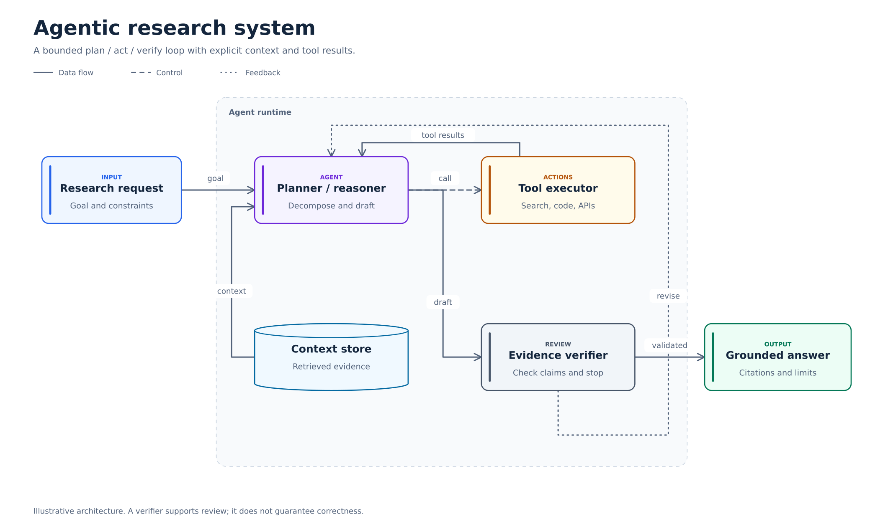
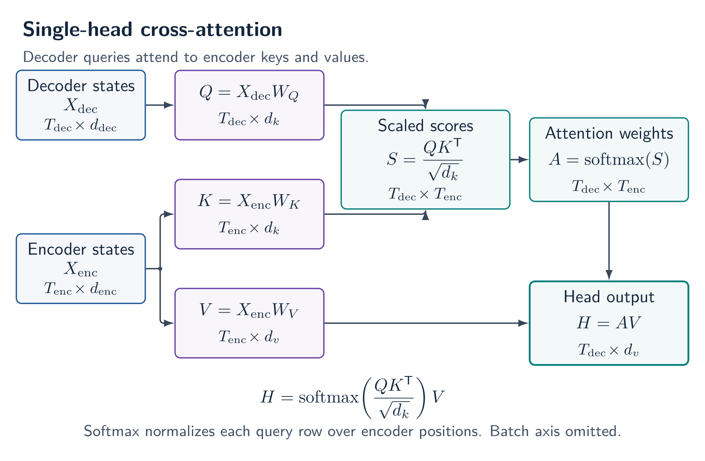
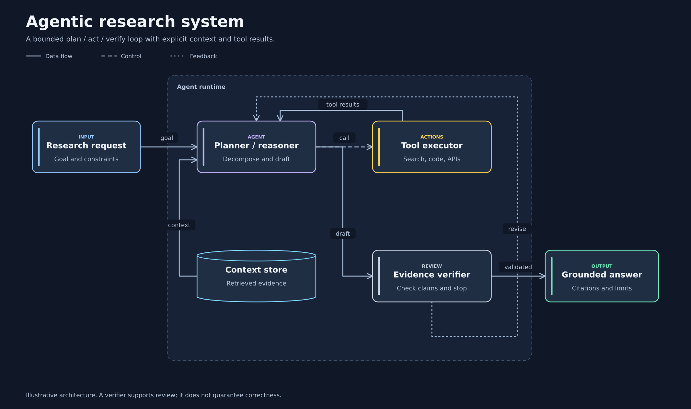

# ArchDiagram Studio

**An installable agent skill for precise, editable AI architecture diagrams.**

Turn model code, papers, and architecture briefs into figures with clear data flow, accurate boundaries, explicit assumptions, and reproducible source. Built for agentic AI, RAG, transformers, CNNs, graph networks, robotics, and software systems.

[Explore the live gallery](https://huggingface.co/spaces/Nabidnur/archdiagram-studio) · [Install and use](docs/USAGE.md) · [Skill instructions](skills/draw-architecture/SKILL.md) · [Scene specification](skills/draw-architecture/references/specification.md) · [Reference catalog](skills/draw-architecture/references/sources.md)



## What you get

- **A portable agent skill:** evidence extraction, architecture-specific recipes, backend selection, rendering, visual review, and an explicit handoff.
- **An original Python renderer:** JSON to editable SVG and standalone TikZ, using the standard library. Optional Inkscape PNG/PDF exports and TeX verification.
- **Six worked architectures in three themes:** Paper, Midnight, and Blueprint; each with JSON, SVG, TikZ, PNG, and PDF files.
- **Three native TikZ templates:** mathematical self-attention, cross-attention, and a neuron-level multilayer perceptron.
- **Geometry checks:** overlapping blocks, approximate text fit, bounds, routes through unrelated nodes, and label collisions. These support visual review; they do not replace it.
- **A browsable Hugging Face Space:** choose an example/theme, zoom, download source, and compose a prompt for your own agent.
- **A pinned catalog of all 11 unique requested references:** contribution areas and file-level license observations, with no upstream source or images vendored.

This is a skill and figure toolkit. It does not contain model weights, train a diagram model, or guarantee architectural correctness from arbitrary code. Its value comes from a concrete workflow, editable assets, deterministic rendering, and review.

## Install

```bash
git clone https://github.com/Hisernberg/archdiagram-studio.git
cd archdiagram-studio
python scripts/install_skill.py --agent codex
```

For Claude, use `--agent claude`. For another assistant, copy the complete `skills/draw-architecture` folder or point it at that folder's `SKILL.md`. See [installation details](docs/USAGE.md), including custom destinations and host refresh behavior.

Then ask:

> Use $draw-architecture to turn my model code into a technical architecture diagram. Keep text editable, verify tensor labels and residual paths, inspect the rendered result, and deliver SVG, JSON, TikZ, and a short caption with assumptions.

No API key is needed by this repository's renderer or static gallery. Your chosen agent supplies the reasoning and code inspection.

## Render without an agent

```bash
python skills/draw-architecture/scripts/archdiagram.py render \
  skills/draw-architecture/assets/examples/agentic-research.json \
  --out output/my-agent --formats svg,tex --theme paper --strict
```

SVG and TeX source need **Python 3.10+ only**. Add `png,pdf` to `--formats` when **Inkscape** is installed. Add `--compile-tex` for a separate `.tikz.pdf` compiled by local **LuaLaTeX/pdfLaTeX**. The compiler tries available engines and records which succeeds. See [TeX, fonts, and export](skills/draw-architecture/references/tikz.md) for dependencies, non-Latin text, and differences between PDF routes.

```bash
python skills/draw-architecture/scripts/archdiagram.py validate your-diagram.json --strict
python -m unittest discover -s tests -v
python scripts/build_gallery.py --compile-tex
```

The JSON format supports explicit or grid coordinates, five shape kinds, eight semantic color roles, container groups, separate data/control/feedback line patterns, side-relative port offsets, and manual polyline waypoints. Automatic layout is a starting grid; it is not an obstacle-avoiding graph optimizer. The [complete specification](skills/draw-architecture/references/specification.md) describes the supported fields and limits.

## Architecture gallery

All examples below are original, illustrative designs. Adapt them to actual code or system evidence.

| Architecture | What it makes explicit | Editable source |
|---|---|---|
| [Agentic research](gallery/agentic-research.svg) | Tool calls/results, context reads, verification, revision | [JSON](skills/draw-architecture/assets/examples/agentic-research.json) · [TikZ](gallery/agentic-research.tex) |
| [RAG pipeline](gallery/rag-pipeline.svg) | Indexing and query-time evidence paths | [JSON](skills/draw-architecture/assets/examples/rag-pipeline.json) · [TikZ](gallery/rag-pipeline.tex) |
| [Pre-norm transformer](gallery/transformer-layer.svg) | Two distinct residual origins and causal attention | [JSON](skills/draw-architecture/assets/examples/transformer-layer.json) · [TikZ](gallery/transformer-layer.tex) |
| [CNN classifier](gallery/cnn-classifier.svg) | Feature shapes, spatial reduction, pooling, logits | [JSON](skills/draw-architecture/assets/examples/cnn-classifier.json) · [TikZ](gallery/cnn-classifier.tex) |
| [Robot control](gallery/robot-control.svg) | Observation, estimated state, command, physical dynamics | [JSON](skills/draw-architecture/assets/examples/robot-control.json) · [TikZ](gallery/robot-control.tex) |
| [GNN message passing](gallery/gnn-message-passing.svg) | Messages, aggregation, node updates, readout | [JSON](skills/draw-architecture/assets/examples/gnn-message-passing.json) · [TikZ](gallery/gnn-message-passing.tex) |

### Mathematical and neuron-level figures



[Cross-attention source](skills/draw-architecture/assets/templates/cross-attention.tex) · [Self-attention source](skills/draw-architecture/assets/templates/transformer-attention.tex) · [MLP source](skills/draw-architecture/assets/templates/mlp.tex)

### One architecture, three themes



Use `--theme paper`, `--theme midnight`, or `--theme blueprint`. Theme affects appearance, not the architecture. The gallery downloads match the selected theme.

## The agent workflow

1. **Establish the contract.** Identify the audience, architecture question, abstraction level, final width, and evidence.
2. **Inventory components and edges.** Confirm data/control semantics, boundaries, repeats, dimensions, and unknowns.
3. **Choose the representation.** Use JSON/SVG for system topology, perspective tensor nodes for CNNs, and native TikZ for equations or neuron diagrams.
4. **Render and check.** Run geometry checks, inspect the actual image at full and final display sizes, correct problems, and compare back to the evidence.
5. **Deliver source with the figure.** Include editable files, caption, assumptions, and the checks actually performed.

See the [quality rubric](skills/draw-architecture/references/quality.md), [architecture recipes](skills/draw-architecture/references/recipes.md), and [code-to-diagram guide](skills/draw-architecture/references/code-to-diagram.md).

## Requested ecosystem, carefully cataloged

The catalog covers [NNTikZ](https://github.com/fraserlove/nntikz), [PlotNeuralNet](https://github.com/harisiqbal88/PlotNeuralNet), [awesome-latex-drawing](https://github.com/xinychen/awesome-latex-drawing), [awesome-tikz](https://github.com/xiaohanyu/awesome-tikz), [PetarV-/TikZ](https://github.com/PetarV-/TikZ), [nndiagram](https://github.com/ccfang2/nndiagram), [pytorch2tikz](https://github.com/FraunhoferHHI/pytorch2tikz), [transformer-verif](https://github.com/pzeina/transformer-verif), [tikz-codes](https://github.com/shrenikvz/tikz-codes), [Tikz_graphs](https://github.com/LIVazquezS/Tikz_graphs), and [nn_graphics](https://github.com/mvoelk/nn_graphics).

These are **reference-only entries**, with pinned commits and observed licenses. The duplicate awesome-tikz link was deduplicated. The unqualified `nn_graphics` name was interpreted as mvoelk/nn_graphics. In particular, pytorch2tikz uses a custom academic/non-commercial license, and several repositories have no clear repository license. They are not bundled or automatically installed. See [sources and attribution](skills/draw-architecture/references/sources.md) and the [machine-readable catalog](skills/draw-architecture/references/source-catalog.json).

## Validation and limits

The portable tests exercise validation, escaped text, deterministic source output, geometry diagnostics, the CLI, and safe installer behavior. The gallery build renders 18 themed scenes, compiles all six paper-theme TikZ scenes, and compiles the three native templates. Two fresh agent tasks also exercised a new RAG revision loop and cross-attention adaptation. [Validation notes](docs/VALIDATION.md) distinguish these checks from hosted CI and from architectural proof.

The linter uses approximate text metrics and rectangular bounds. It does not infer a complete execution graph, prove semantic correctness, detect every ambiguous line crossing, or guarantee readable text after arbitrary downscaling. Fonts must exist on the viewer/exporter; CJK TeX needs additional configuration. Native templates are the route for mathematical notation because JSON text is escaped literally.

## Repository map

| Path | Contents |
|---|---|
| `skills/draw-architecture/` | Complete installable skill, renderer, references, JSON examples, native TeX |
| `scripts/` | Installer and gallery builder |
| `gallery/` | Reproducible source, rendered figures, reports, manifest |
| `index.html`, `app/` | Static gallery and local prompt composer |
| `tests/` | Portable standard-library tests |
| `docs/` | Human usage and actual validation notes |

The Hugging Face Space is a static gallery and downloadable repository, not a model inference endpoint. The same source is available on [GitHub](https://github.com/Hisernberg/archdiagram-studio) and [Hugging Face](https://huggingface.co/spaces/Nabidnur/archdiagram-studio/tree/main).

## License and citation

Original code, templates, diagrams, and prose: **MIT**, copyright 2026 URAD. External projects retain their own licenses and authorship. No affiliation or endorsement is implied. See [LICENSE](LICENSE), [CITATION.cff](CITATION.cff), and [contribution guidance](CONTRIBUTING.md).
