# ArchDiagram Studio

**100 original monochrome TikZ architecture diagrams, with an installable skill for creating your own.**

Vision, language, audio, video, multimodal systems, agents, robotics, and graph learning. Real LaTeX typography, thin black rules, restrained gray fills, meaningful equations, and editable source. No generated raster artwork is used for technical geometry.

[Live searchable gallery](https://huggingface.co/spaces/Nabidnur/archdiagram-studio) · [All 100 figures and downloads](docs/ATLAS.md) · [Install and use](docs/USAGE.md) · [Agent skill](skills/draw-architecture/SKILL.md)

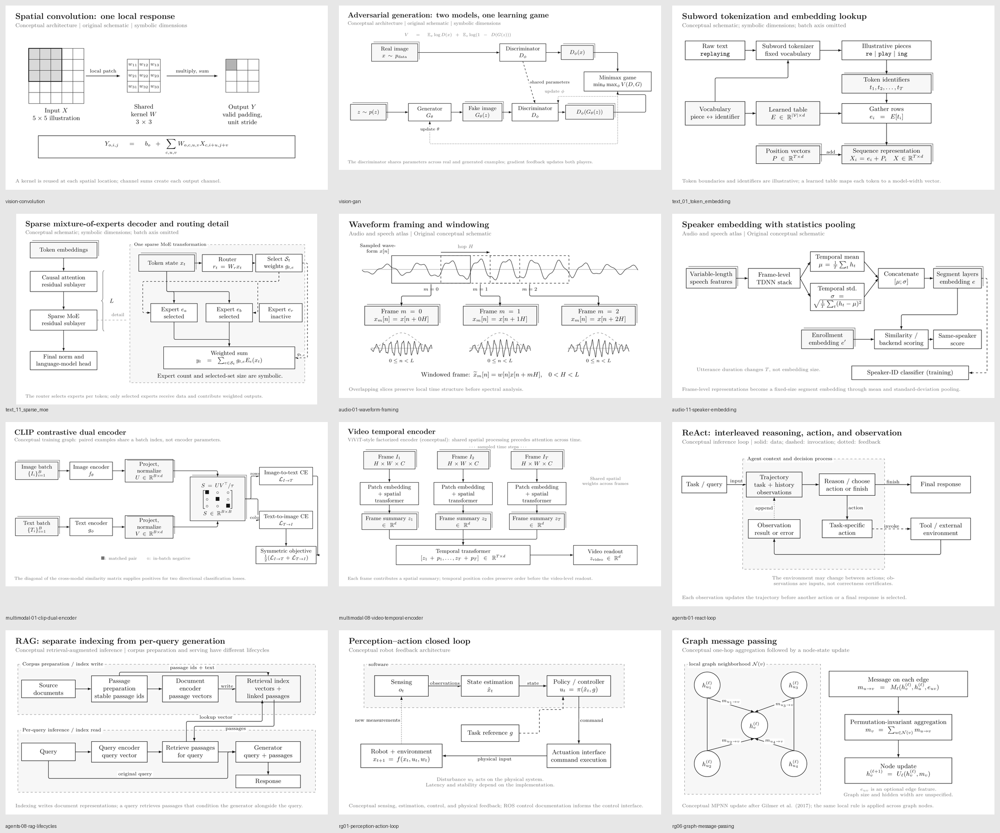

## What is included

| Family | Figures | Examples |
|---|---:|---|
| Vision | 20 | U-Net, FPN, ViT, Swin, MAE, VAE, diffusion, DETR, detection |
| Language and sequences | 20 | Decoder towers, attention, GQA, KV cache, RoPE, SwiGLU, MoE, LoRA, state-space models |
| Audio and speech | 20 | STFT, CTC, RNN-T, Conformer, Whisper, wav2vec2, TTS, vocoders, neural codecs |
| Multimodal and video | 15 | CLIP, vision-language bridges, resamplers, video time encoding, audiovisual fusion, document models |
| Agentic systems | 15 | ReAct, planning, tools, reflection, orchestration, RAG, memory, approval, execution, serving |
| Robotics and graphs | 10 | Control loops, MPC, sim-to-real, sensor fusion, message passing, GAT, heterogeneous and temporal graphs |
| **Total** | **100** | **100 standalone editable TikZ masters** |

Each atlas figure has a TikZ master, vector PDF, SVG preview, PNG, primary-source links, and explicit assumptions. The diagrams are original **conceptual schematics**, rather than claims that every checkpoint uses precisely the pictured implementation.

The installable skill adds evidence extraction, template search, architecture recipes, semantic review, geometry checks, compilation, and visual inspection. It also includes an original JSON-to-SVG/TikZ renderer for work that needs editable SVG text.

## Install the skill

~~~bash
git clone https://github.com/Hisernberg/archdiagram-studio.git
cd archdiagram-studio
python scripts/install_skill.py --agent codex
~~~

Use <code>--agent claude</code> for Claude or <code>--dest /your/skills</code> for another location. The installer preserves a different existing skill unless replacement is explicitly requested. Other assistants can read the complete <code>skills/draw-architecture</code> folder.

Ask your agent:

> Use $draw-architecture to diagram my architecture in black and white. Search the 100-figure atlas for a starting point, use my code or paper as evidence, preserve real mathematical notation, inspect the compiled figure, and return editable source plus a caption and assumptions.

## Find, copy, and compile a template

~~~bash
python skills/draw-architecture/scripts/atlas.py find "cross attention"
python skills/draw-architecture/scripts/atlas.py list --family vision
python skills/draw-architecture/scripts/atlas.py copy \
  --id text_05_cross_attention --out output/figure.tex
pdflatex -no-shell-escape -halt-on-error \
  -output-directory output output/figure.tex
~~~

The atlas masters are self-contained .tex files. Compile with PGF/TikZ, standalone, Latin Modern, and amsmath/amssymb installed. PDF/PNG/SVG export builds additionally use Poppler. Searching/copying templates needs Python 3.10+ only.

For a custom editable-text SVG, use the separate JSON scene renderer:

~~~bash
python skills/draw-architecture/scripts/archdiagram.py render \
  skills/draw-architecture/assets/examples/agentic-research.json \
  --out output/my-agent --formats svg,tex --theme paper --strict
~~~

The paper theme is monochrome. Atlas SVG previews are derived from PDFs and use **outlined glyphs**; edit their native TikZ source. The JSON renderer preserves SVG text. [Format and font details](skills/draw-architecture/references/tikz.md) · [Native authoring guide](skills/draw-architecture/references/atlas-authoring.md).

## All 100 README demos

Expand a family. Every thumbnail links to a full-resolution figure; each caption also links to the editable TikZ master and PDF.

<strong>Vision — 20 original diagrams</strong>

| Figure | Figure |
|---|---|
| [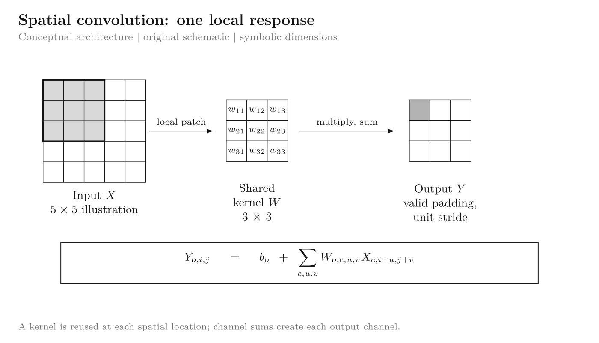](gallery/atlas/vision-convolution.svg) **Spatial convolution: one local response** [TikZ](skills/draw-architecture/assets/atlas/vision/vision-convolution.tex) · [PDF](gallery/atlas/vision-convolution.pdf) · [PNG](gallery/atlas/vision-convolution.png) | [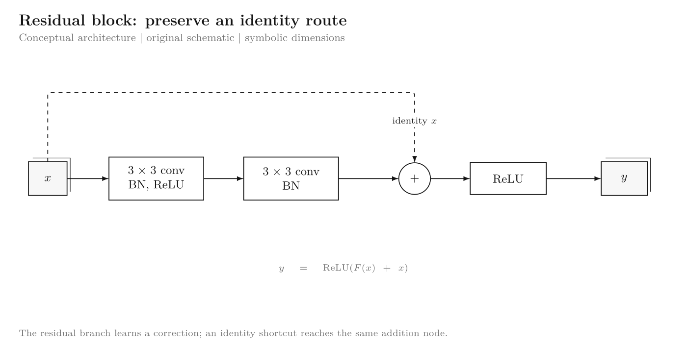](gallery/atlas/vision-residual-block.svg) **Residual block: preserve an identity route** [TikZ](skills/draw-architecture/assets/atlas/vision/vision-residual-block.tex) · [PDF](gallery/atlas/vision-residual-block.pdf) · [PNG](gallery/atlas/vision-residual-block.png) |
| [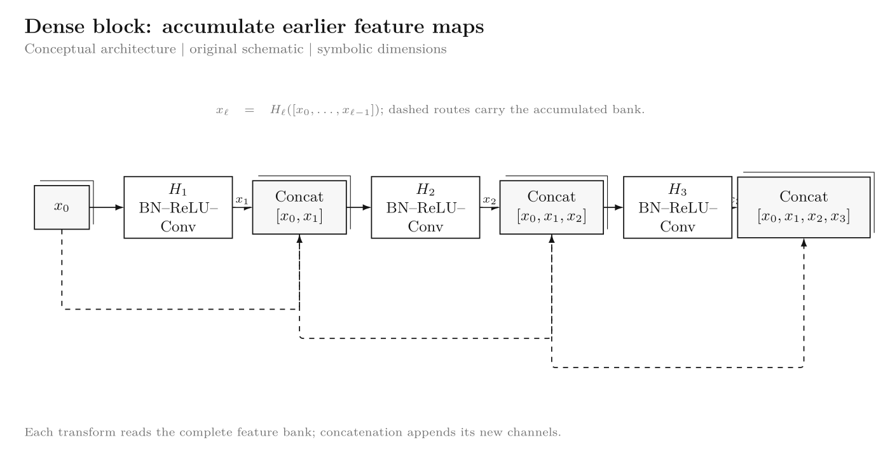](gallery/atlas/vision-dense-block.svg) **Dense block: accumulate earlier feature maps** [TikZ](skills/draw-architecture/assets/atlas/vision/vision-dense-block.tex) · [PDF](gallery/atlas/vision-dense-block.pdf) · [PNG](gallery/atlas/vision-dense-block.png) | [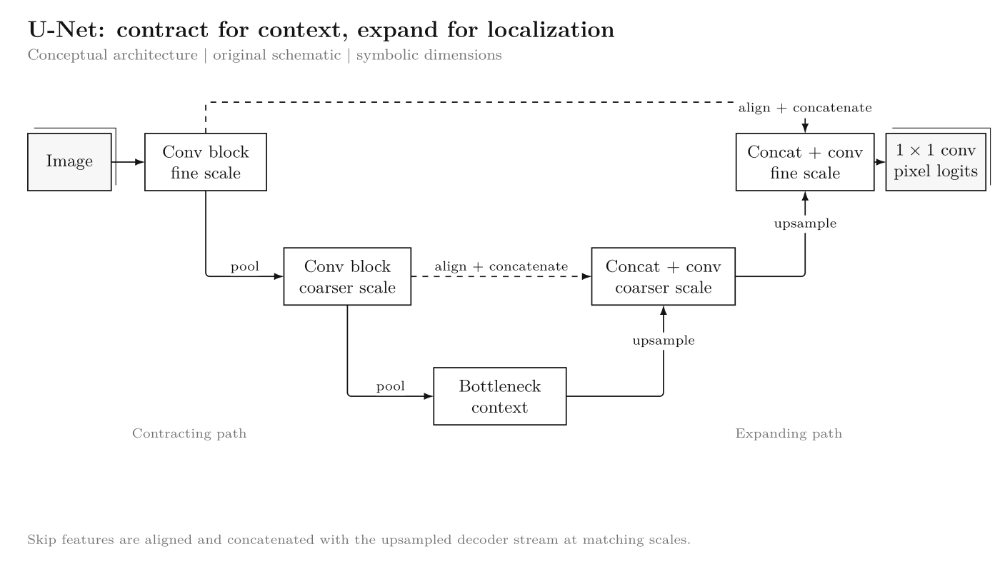](gallery/atlas/vision-unet.svg) **U-Net: contract for context, expand for localization** [TikZ](skills/draw-architecture/assets/atlas/vision/vision-unet.tex) · [PDF](gallery/atlas/vision-unet.pdf) · [PNG](gallery/atlas/vision-unet.png) |
| [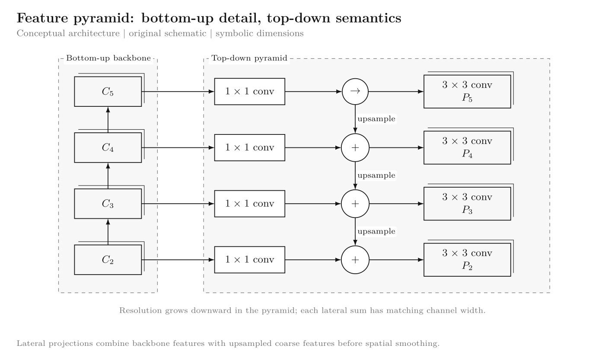](gallery/atlas/vision-feature-pyramid.svg) **Feature pyramid: bottom-up detail, top-down semantics** [TikZ](skills/draw-architecture/assets/atlas/vision/vision-feature-pyramid.tex) · [PDF](gallery/atlas/vision-feature-pyramid.pdf) · [PNG](gallery/atlas/vision-feature-pyramid.png) | [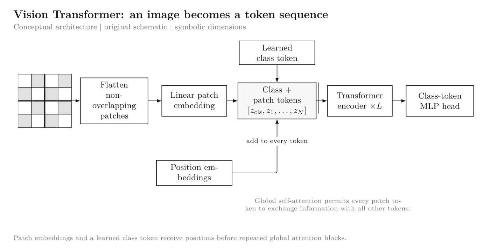](gallery/atlas/vision-vision-transformer.svg) **Vision Transformer: an image becomes a token sequence** [TikZ](skills/draw-architecture/assets/atlas/vision/vision-vision-transformer.tex) · [PDF](gallery/atlas/vision-vision-transformer.pdf) · [PNG](gallery/atlas/vision-vision-transformer.png) |
| [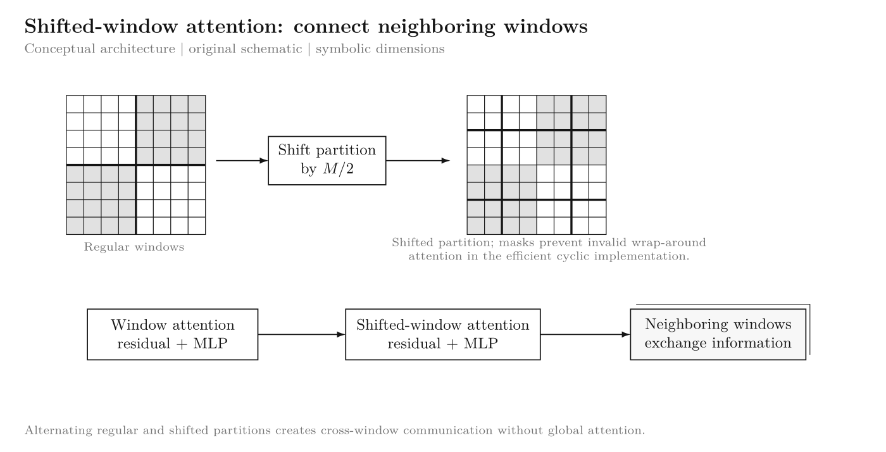](gallery/atlas/vision-shifted-windows.svg) **Shifted-window attention: connect neighboring windows** [TikZ](skills/draw-architecture/assets/atlas/vision/vision-shifted-windows.tex) · [PDF](gallery/atlas/vision-shifted-windows.pdf) · [PNG](gallery/atlas/vision-shifted-windows.png) | [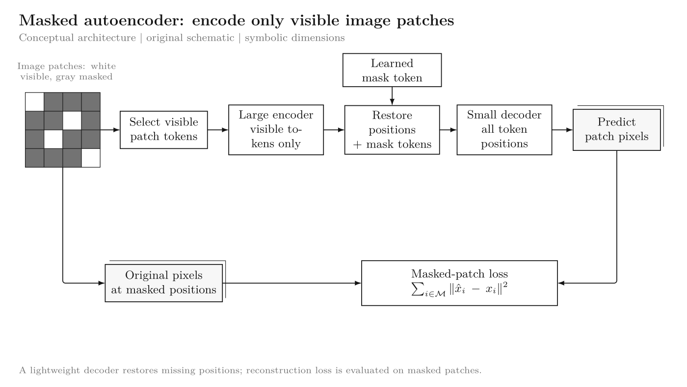](gallery/atlas/vision-masked-autoencoder.svg) **Masked autoencoder: encode only visible image patches** [TikZ](skills/draw-architecture/assets/atlas/vision/vision-masked-autoencoder.tex) · [PDF](gallery/atlas/vision-masked-autoencoder.pdf) · [PNG](gallery/atlas/vision-masked-autoencoder.png) |
| [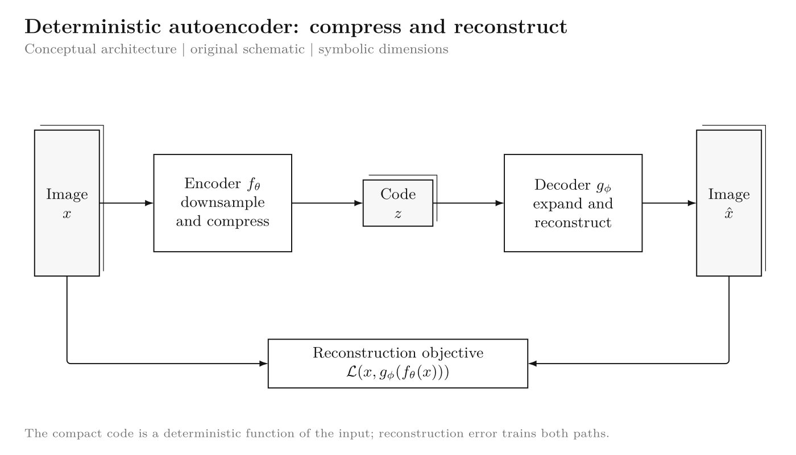](gallery/atlas/vision-deterministic-autoencoder.svg) **Deterministic autoencoder: compress and reconstruct** [TikZ](skills/draw-architecture/assets/atlas/vision/vision-deterministic-autoencoder.tex) · [PDF](gallery/atlas/vision-deterministic-autoencoder.pdf) · [PNG](gallery/atlas/vision-deterministic-autoencoder.png) | [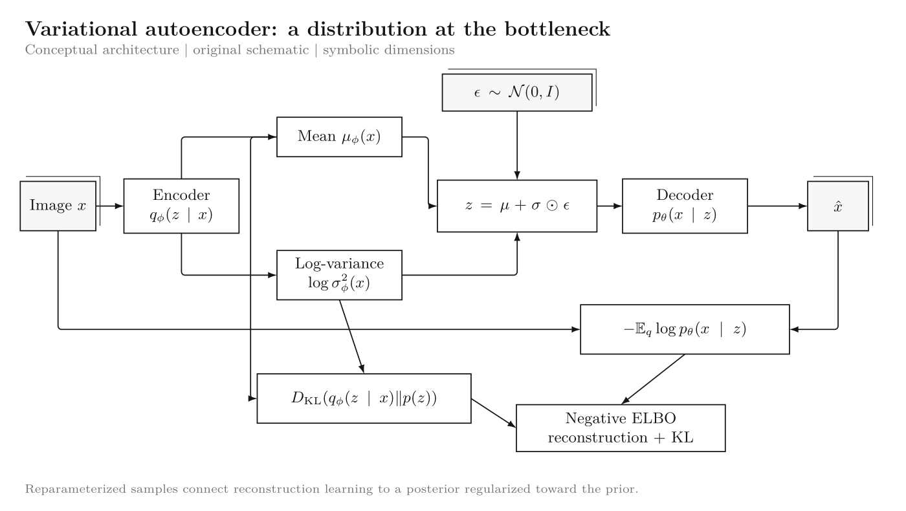](gallery/atlas/vision-variational-autoencoder.svg) **Variational autoencoder: a distribution at the bottleneck** [TikZ](skills/draw-architecture/assets/atlas/vision/vision-variational-autoencoder.tex) · [PDF](gallery/atlas/vision-variational-autoencoder.pdf) · [PNG](gallery/atlas/vision-variational-autoencoder.png) |
| [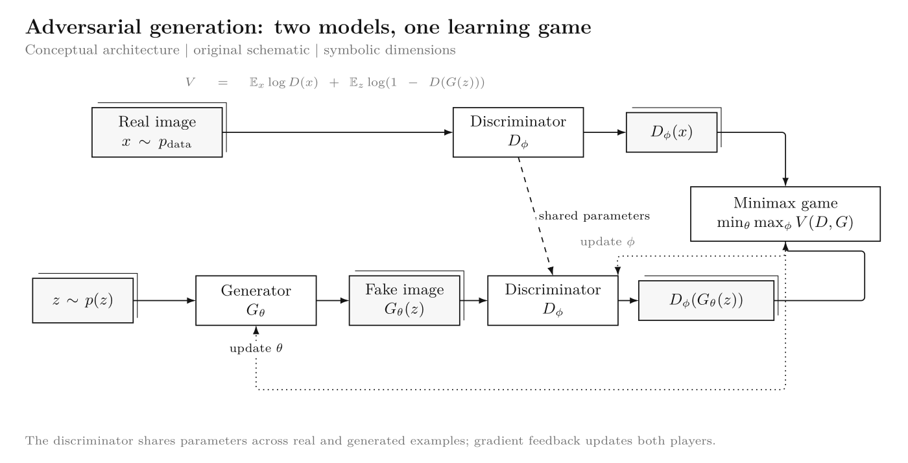](gallery/atlas/vision-gan.svg) **Adversarial generation: two models, one learning game** [TikZ](skills/draw-architecture/assets/atlas/vision/vision-gan.tex) · [PDF](gallery/atlas/vision-gan.pdf) · [PNG](gallery/atlas/vision-gan.png) | [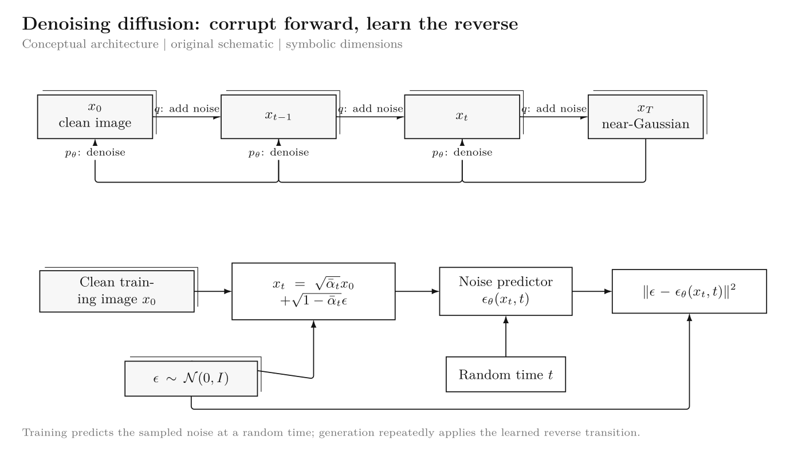](gallery/atlas/vision-ddpm.svg) **Denoising diffusion: corrupt forward, learn the reverse** [TikZ](skills/draw-architecture/assets/atlas/vision/vision-ddpm.tex) · [PDF](gallery/atlas/vision-ddpm.pdf) · [PNG](gallery/atlas/vision-ddpm.png) |
| [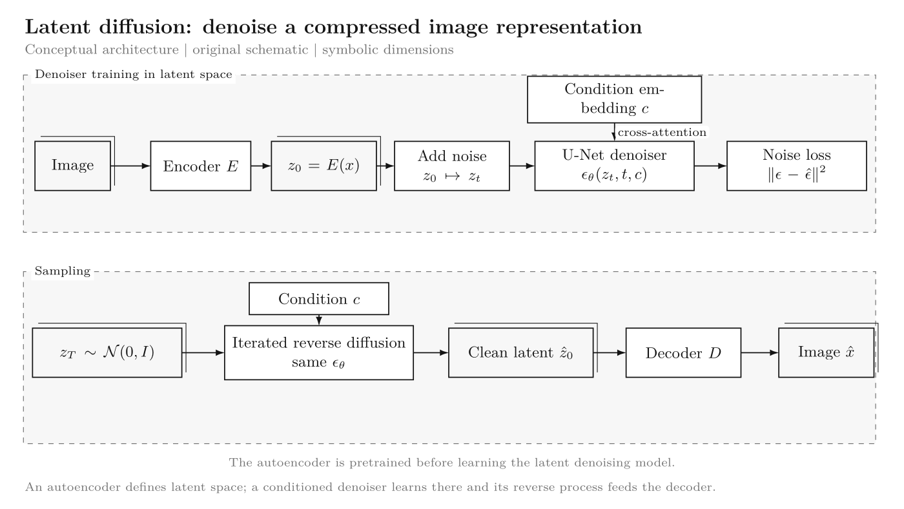](gallery/atlas/vision-latent-diffusion.svg) **Latent diffusion: denoise a compressed image representation** [TikZ](skills/draw-architecture/assets/atlas/vision/vision-latent-diffusion.tex) · [PDF](gallery/atlas/vision-latent-diffusion.pdf) · [PNG](gallery/atlas/vision-latent-diffusion.png) | [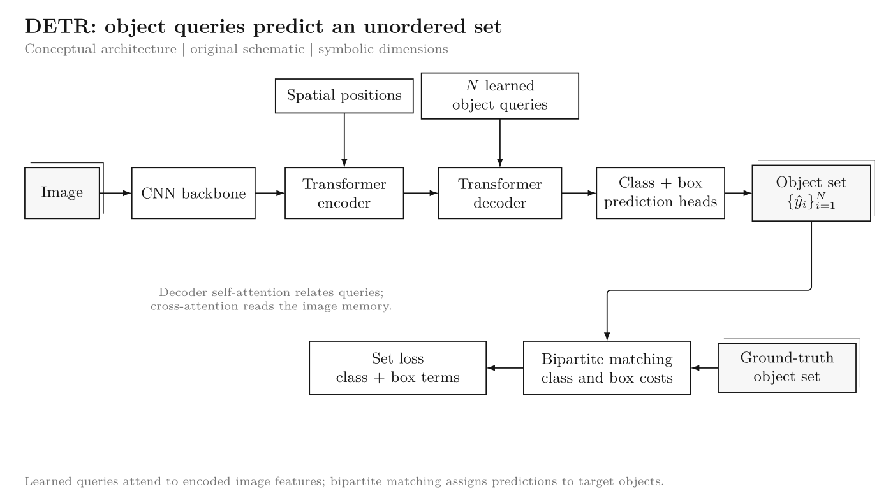](gallery/atlas/vision-detr.svg) **DETR: object queries predict an unordered set** [TikZ](skills/draw-architecture/assets/atlas/vision/vision-detr.tex) · [PDF](gallery/atlas/vision-detr.pdf) · [PNG](gallery/atlas/vision-detr.png) |
| [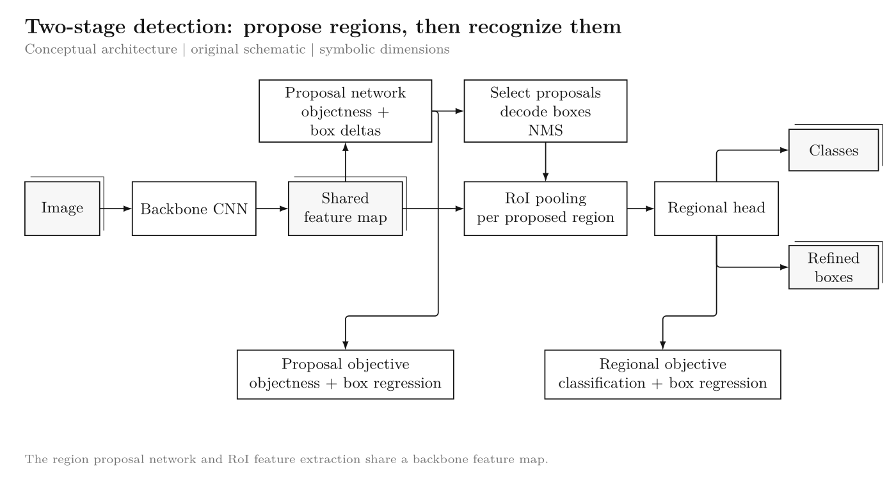](gallery/atlas/vision-two-stage-detector.svg) **Two-stage detection: propose regions, then recognize them** [TikZ](skills/draw-architecture/assets/atlas/vision/vision-two-stage-detector.tex) · [PDF](gallery/atlas/vision-two-stage-detector.pdf) · [PNG](gallery/atlas/vision-two-stage-detector.png) | [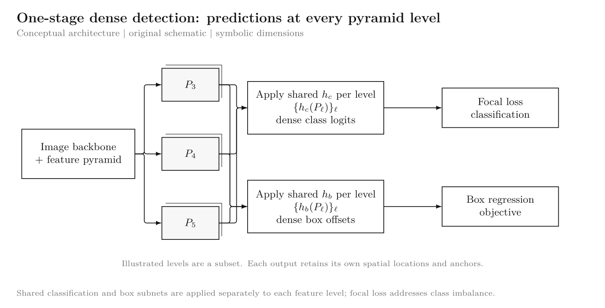](gallery/atlas/vision-one-stage-detector.svg) **One-stage dense detection: predictions at every pyramid level** [TikZ](skills/draw-architecture/assets/atlas/vision/vision-one-stage-detector.tex) · [PDF](gallery/atlas/vision-one-stage-detector.pdf) · [PNG](gallery/atlas/vision-one-stage-detector.png) |
| [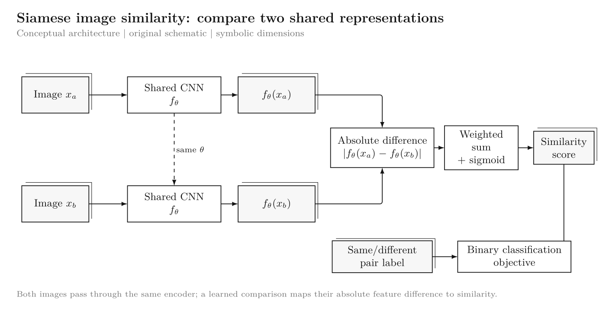](gallery/atlas/vision-siamese-similarity.svg) **Siamese image similarity: compare two shared representations** [TikZ](skills/draw-architecture/assets/atlas/vision/vision-siamese-similarity.tex) · [PDF](gallery/atlas/vision-siamese-similarity.pdf) · [PNG](gallery/atlas/vision-siamese-similarity.png) | [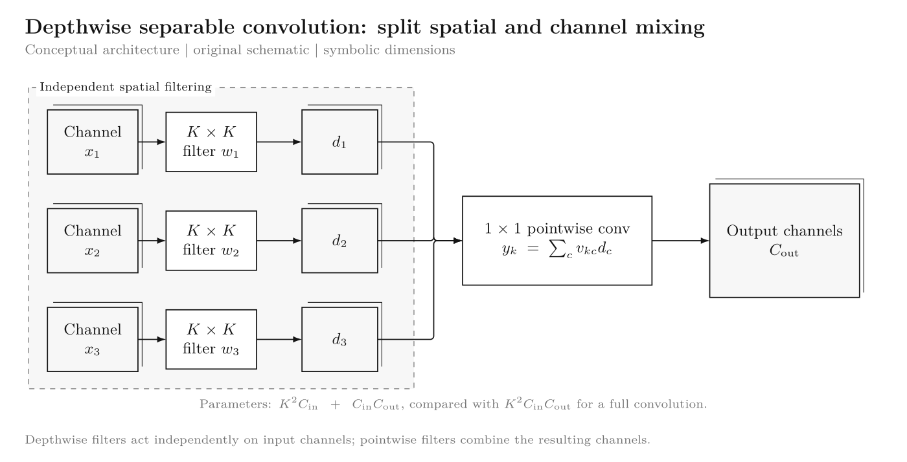](gallery/atlas/vision-depthwise-separable.svg) **Depthwise separable convolution: split spatial and channel mixing** [TikZ](skills/draw-architecture/assets/atlas/vision/vision-depthwise-separable.tex) · [PDF](gallery/atlas/vision-depthwise-separable.pdf) · [PNG](gallery/atlas/vision-depthwise-separable.png) |
| [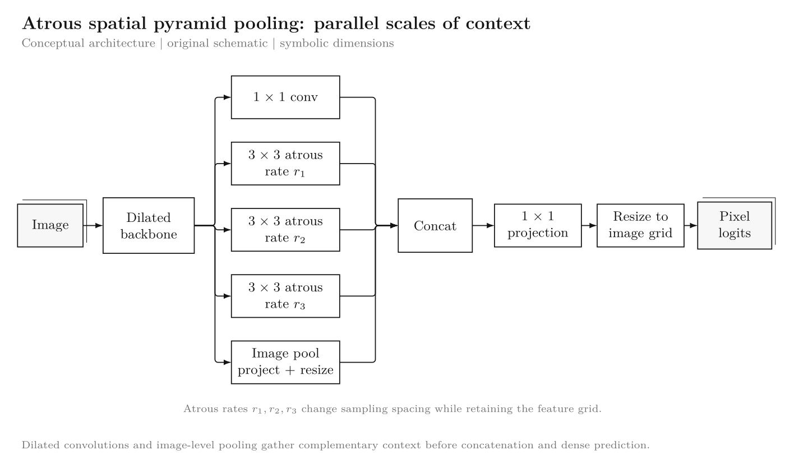](gallery/atlas/vision-atrous-segmentation.svg) **Atrous spatial pyramid pooling: parallel scales of context** [TikZ](skills/draw-architecture/assets/atlas/vision/vision-atrous-segmentation.tex) · [PDF](gallery/atlas/vision-atrous-segmentation.pdf) · [PNG](gallery/atlas/vision-atrous-segmentation.png) | [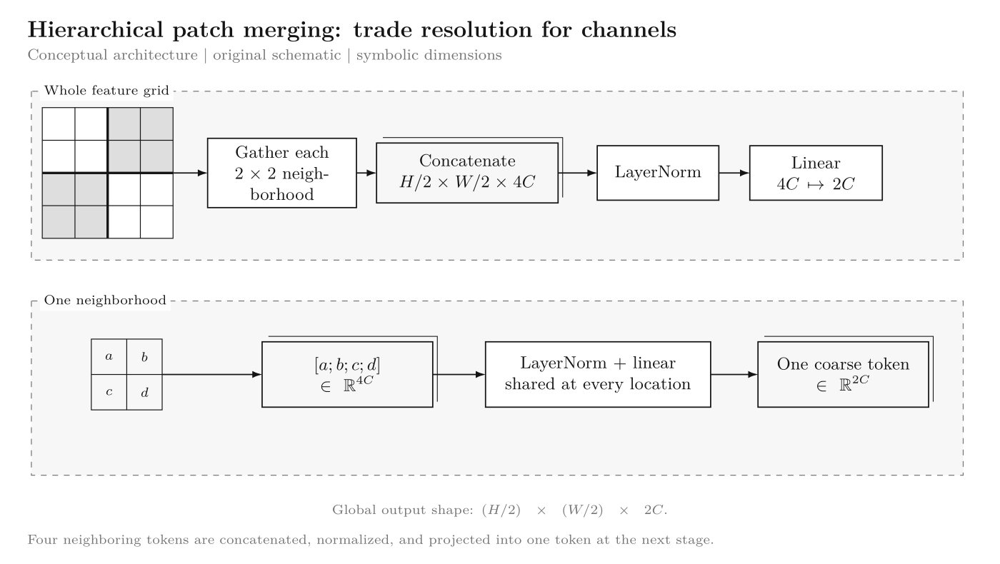](gallery/atlas/vision-patch-merging.svg) **Hierarchical patch merging: trade resolution for channels** [TikZ](skills/draw-architecture/assets/atlas/vision/vision-patch-merging.tex) · [PDF](gallery/atlas/vision-patch-merging.pdf) · [PNG](gallery/atlas/vision-patch-merging.png) |

<strong>Language and sequence models — 20 original diagrams</strong>

| Figure | Figure |
|---|---|
| [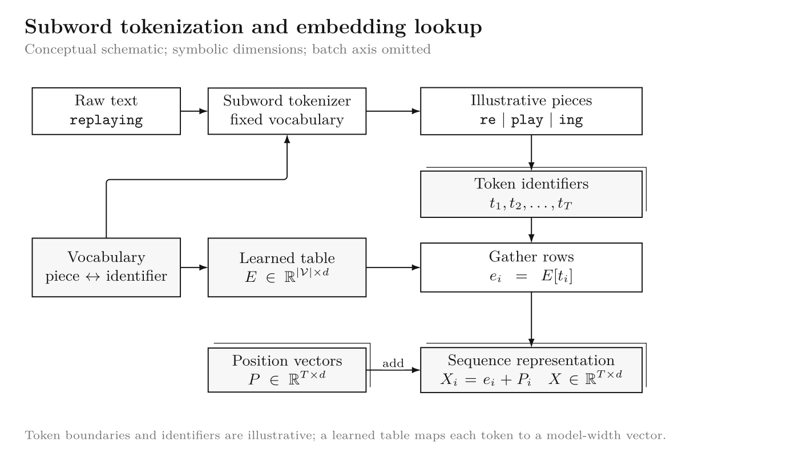](gallery/atlas/text_01_token_embedding.svg) **Subword tokenization and embedding lookup** [TikZ](skills/draw-architecture/assets/atlas/text/text_01_token_embedding.tex) · [PDF](gallery/atlas/text_01_token_embedding.pdf) · [PNG](gallery/atlas/text_01_token_embedding.png) | [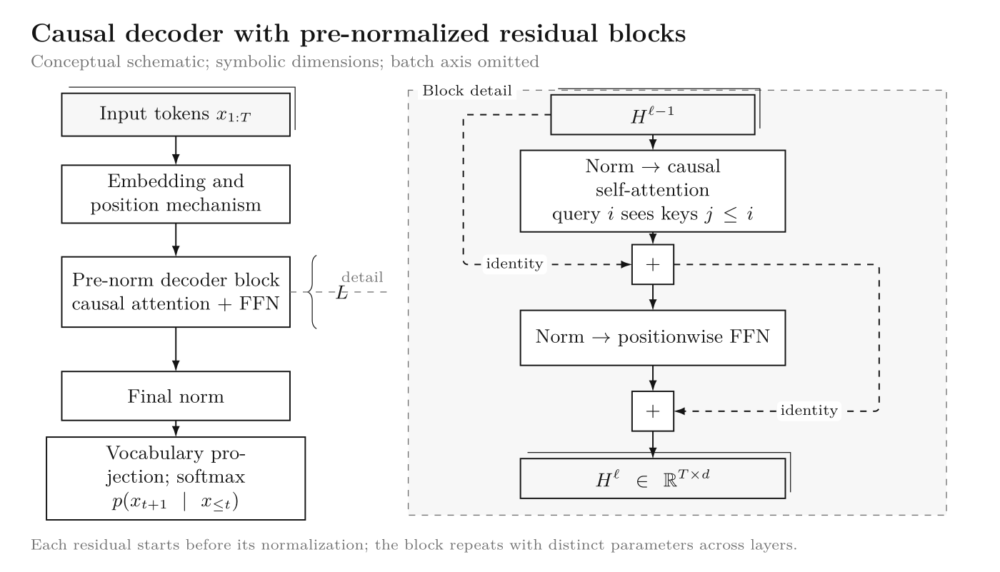](gallery/atlas/text_02_causal_decoder.svg) **Causal decoder with pre-normalized residual blocks** [TikZ](skills/draw-architecture/assets/atlas/text/text_02_causal_decoder.tex) · [PDF](gallery/atlas/text_02_causal_decoder.pdf) · [PNG](gallery/atlas/text_02_causal_decoder.png) |
| [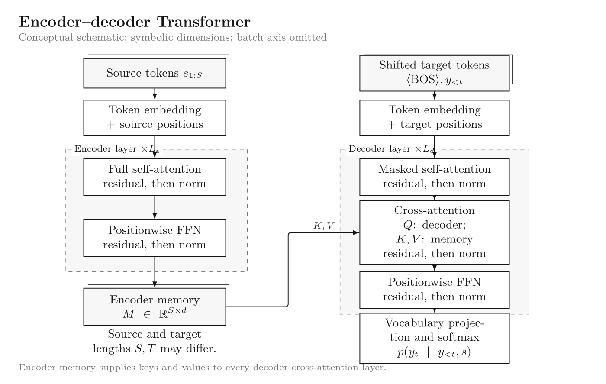](gallery/atlas/text_03_encoder_decoder.svg) **Encoder--decoder Transformer** [TikZ](skills/draw-architecture/assets/atlas/text/text_03_encoder_decoder.tex) · [PDF](gallery/atlas/text_03_encoder_decoder.pdf) · [PNG](gallery/atlas/text_03_encoder_decoder.png) | [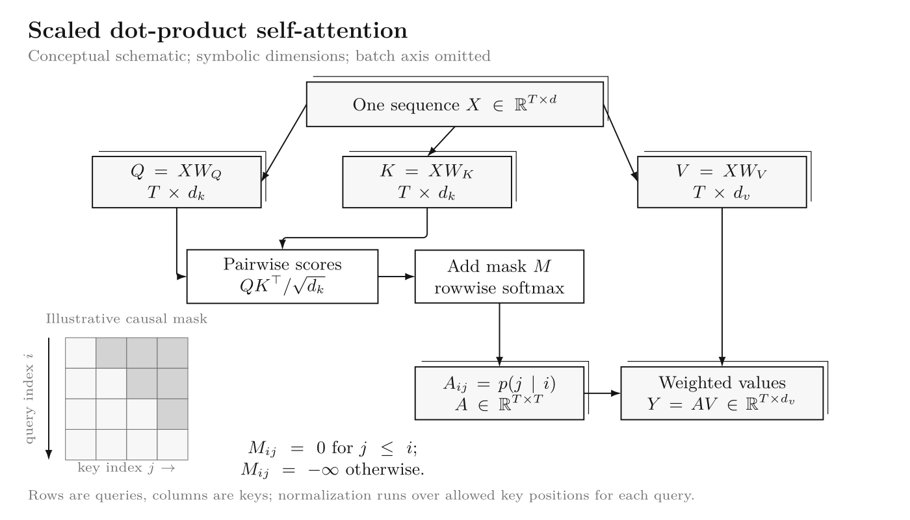](gallery/atlas/text_04_scaled_self_attention.svg) **Scaled dot-product self-attention** [TikZ](skills/draw-architecture/assets/atlas/text/text_04_scaled_self_attention.tex) · [PDF](gallery/atlas/text_04_scaled_self_attention.pdf) · [PNG](gallery/atlas/text_04_scaled_self_attention.png) |
| [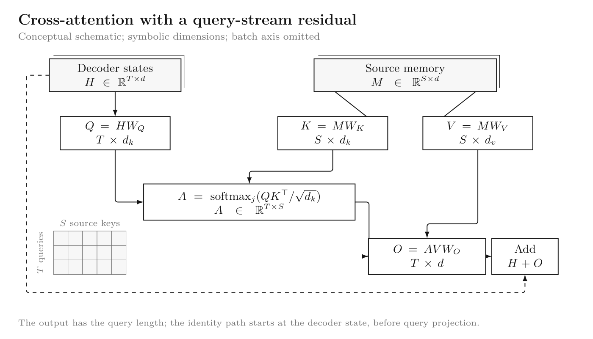](gallery/atlas/text_05_cross_attention.svg) **Cross-attention with a query-stream residual** [TikZ](skills/draw-architecture/assets/atlas/text/text_05_cross_attention.tex) · [PDF](gallery/atlas/text_05_cross_attention.pdf) · [PNG](gallery/atlas/text_05_cross_attention.png) | [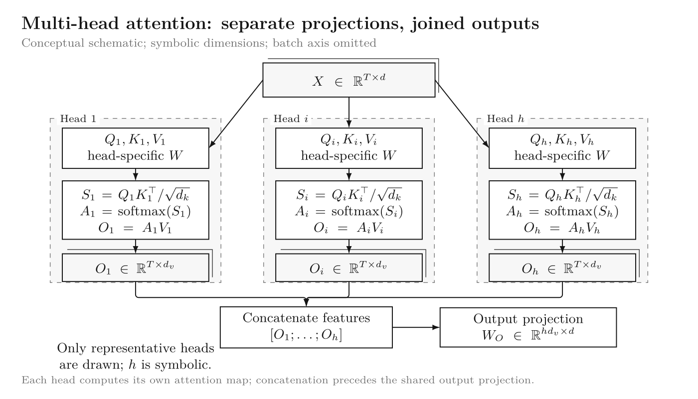](gallery/atlas/text_06_multi_head_attention.svg) **Multi-head attention: separate projections, joined outputs** [TikZ](skills/draw-architecture/assets/atlas/text/text_06_multi_head_attention.tex) · [PDF](gallery/atlas/text_06_multi_head_attention.pdf) · [PNG](gallery/atlas/text_06_multi_head_attention.png) |
| [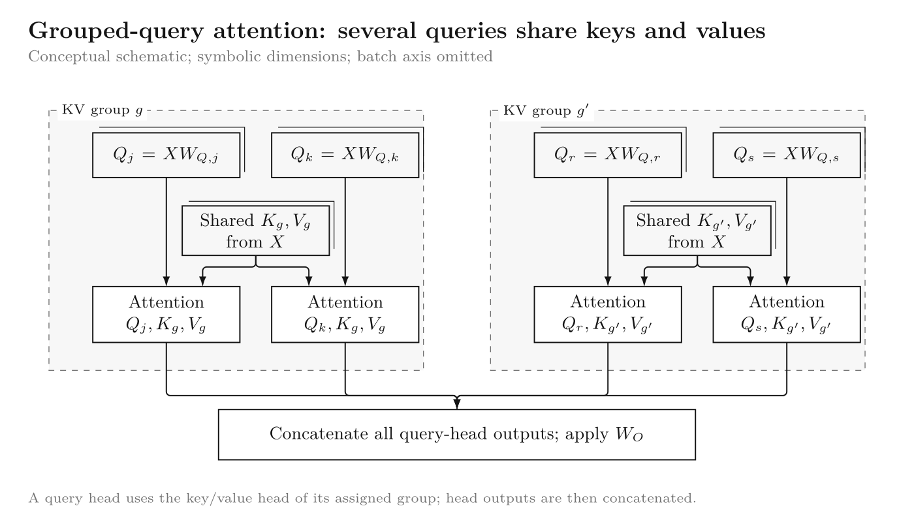](gallery/atlas/text_07_grouped_query_attention.svg) **Grouped-query attention: several queries share keys and values** [TikZ](skills/draw-architecture/assets/atlas/text/text_07_grouped_query_attention.tex) · [PDF](gallery/atlas/text_07_grouped_query_attention.pdf) · [PNG](gallery/atlas/text_07_grouped_query_attention.png) | [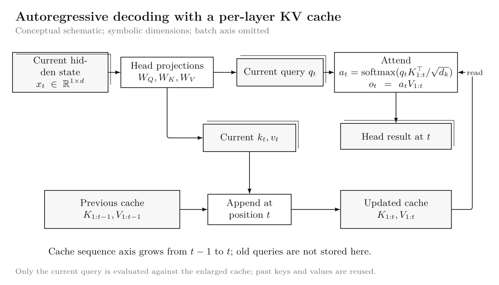](gallery/atlas/text_08_kv_cache.svg) **Autoregressive decoding with a per-layer KV cache** [TikZ](skills/draw-architecture/assets/atlas/text/text_08_kv_cache.tex) · [PDF](gallery/atlas/text_08_kv_cache.pdf) · [PNG](gallery/atlas/text_08_kv_cache.png) |
| [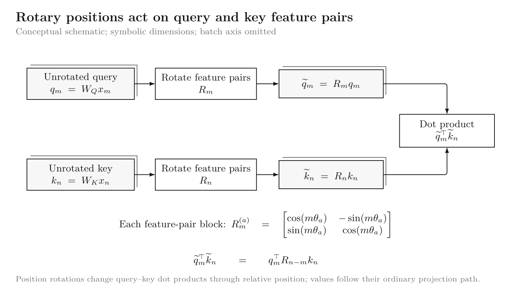](gallery/atlas/text_09_rotary_positions.svg) **Rotary positions act on query and key feature pairs** [TikZ](skills/draw-architecture/assets/atlas/text/text_09_rotary_positions.tex) · [PDF](gallery/atlas/text_09_rotary_positions.pdf) · [PNG](gallery/atlas/text_09_rotary_positions.png) | [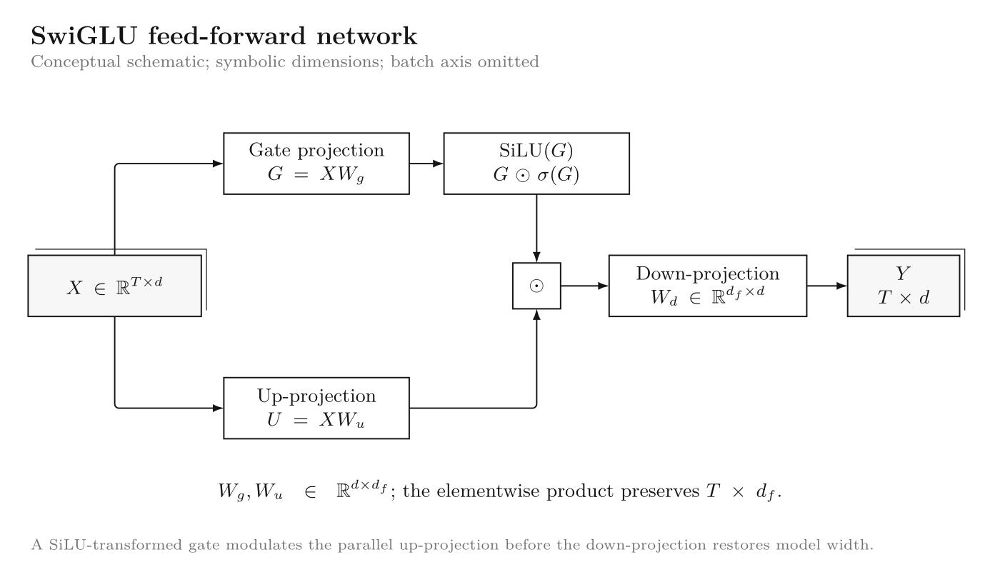](gallery/atlas/text_10_swiglu_ffn.svg) **SwiGLU feed-forward network** [TikZ](skills/draw-architecture/assets/atlas/text/text_10_swiglu_ffn.tex) · [PDF](gallery/atlas/text_10_swiglu_ffn.pdf) · [PNG](gallery/atlas/text_10_swiglu_ffn.png) |
| [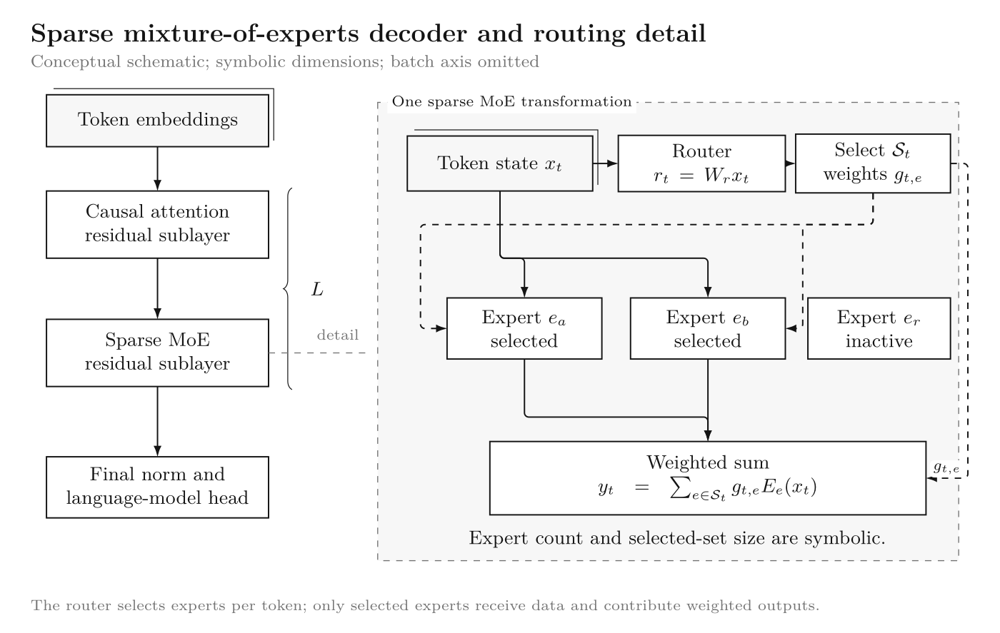](gallery/atlas/text_11_sparse_moe.svg) **Sparse mixture-of-experts decoder and routing detail** [TikZ](skills/draw-architecture/assets/atlas/text/text_11_sparse_moe.tex) · [PDF](gallery/atlas/text_11_sparse_moe.pdf) · [PNG](gallery/atlas/text_11_sparse_moe.png) | [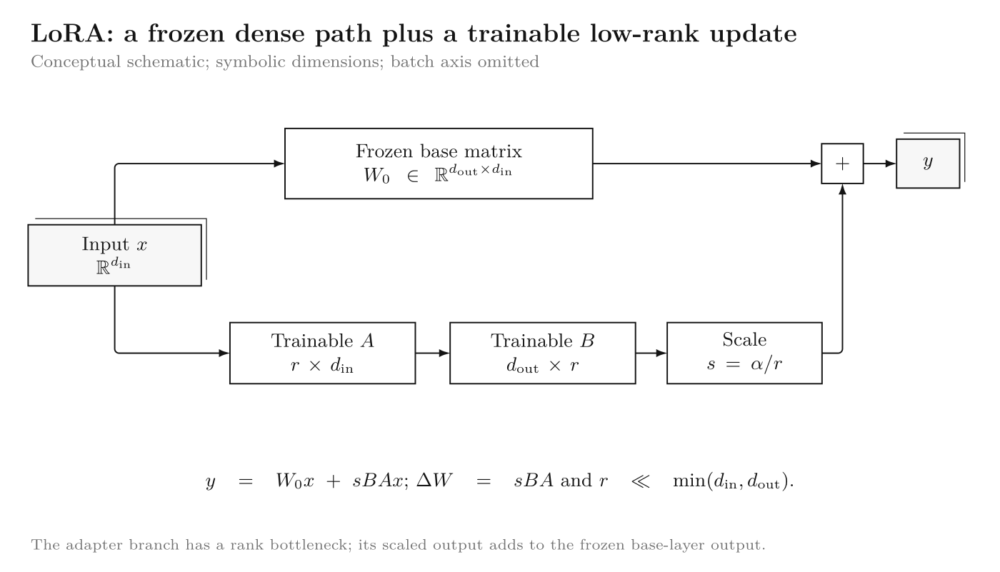](gallery/atlas/text_12_lora.svg) **LoRA: a frozen dense path plus a trainable low-rank update** [TikZ](skills/draw-architecture/assets/atlas/text/text_12_lora.tex) · [PDF](gallery/atlas/text_12_lora.pdf) · [PNG](gallery/atlas/text_12_lora.png) |
| [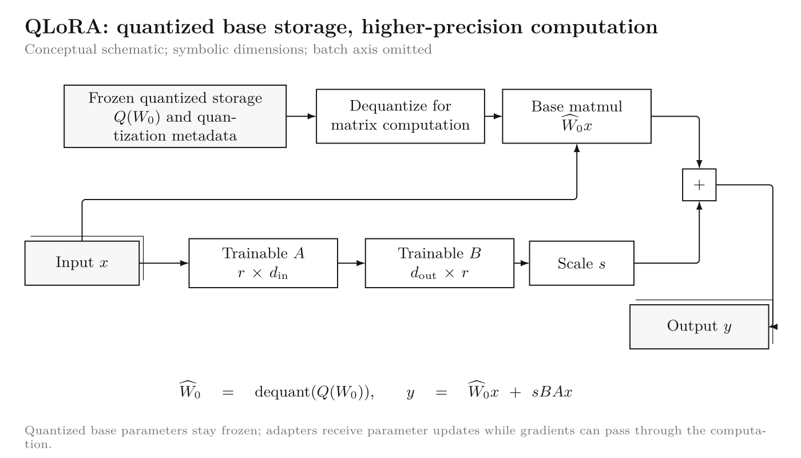](gallery/atlas/text_13_qlora.svg) **QLoRA: quantized base storage, higher-precision computation** [TikZ](skills/draw-architecture/assets/atlas/text/text_13_qlora.tex) · [PDF](gallery/atlas/text_13_qlora.pdf) · [PNG](gallery/atlas/text_13_qlora.png) | [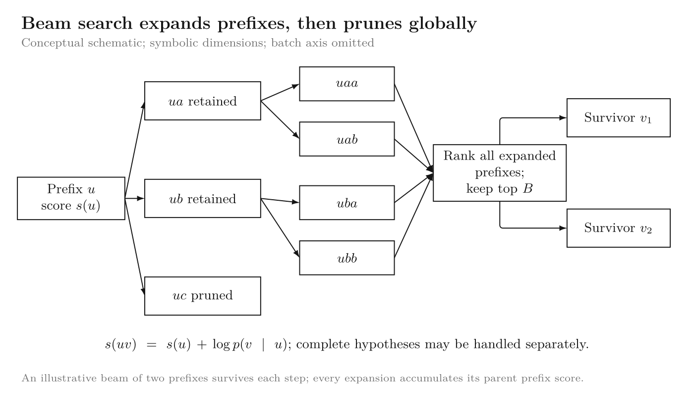](gallery/atlas/text_14_beam_search.svg) **Beam search expands prefixes, then prunes globally** [TikZ](skills/draw-architecture/assets/atlas/text/text_14_beam_search.tex) · [PDF](gallery/atlas/text_14_beam_search.pdf) · [PNG](gallery/atlas/text_14_beam_search.png) |
| [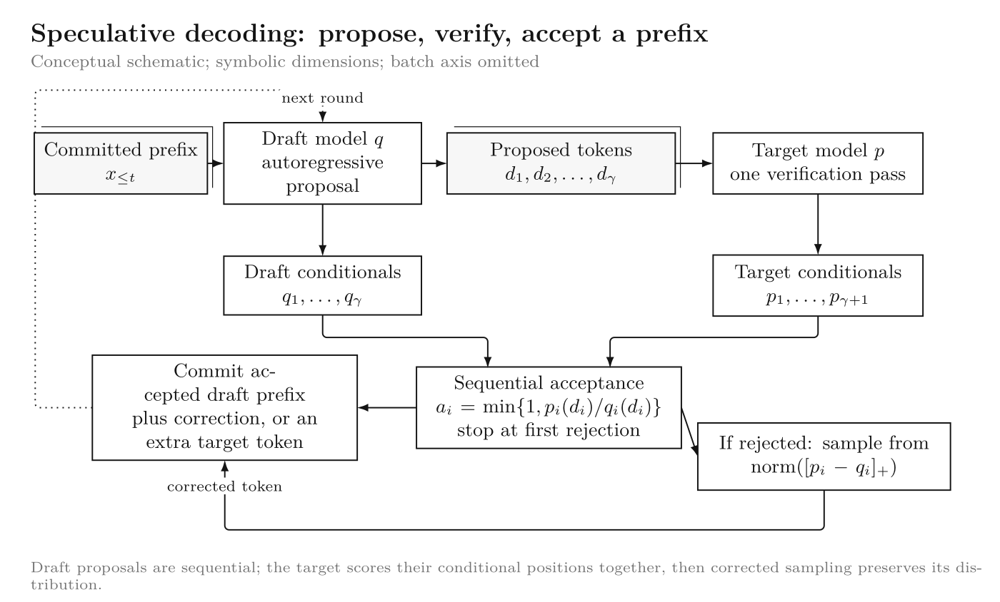](gallery/atlas/text_15_speculative_decoding.svg) **Speculative decoding: propose, verify, accept a prefix** [TikZ](skills/draw-architecture/assets/atlas/text/text_15_speculative_decoding.tex) · [PDF](gallery/atlas/text_15_speculative_decoding.pdf) · [PNG](gallery/atlas/text_15_speculative_decoding.png) | [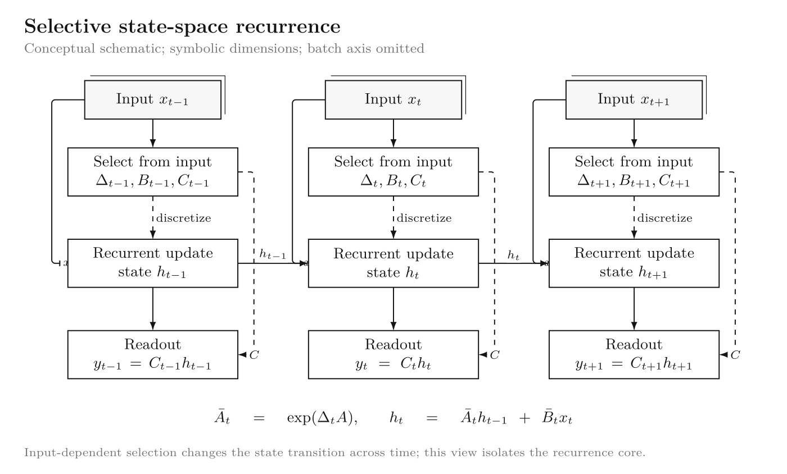](gallery/atlas/text_16_selective_state_space.svg) **Selective state-space recurrence** [TikZ](skills/draw-architecture/assets/atlas/text/text_16_selective_state_space.tex) · [PDF](gallery/atlas/text_16_selective_state_space.pdf) · [PNG](gallery/atlas/text_16_selective_state_space.png) |
| [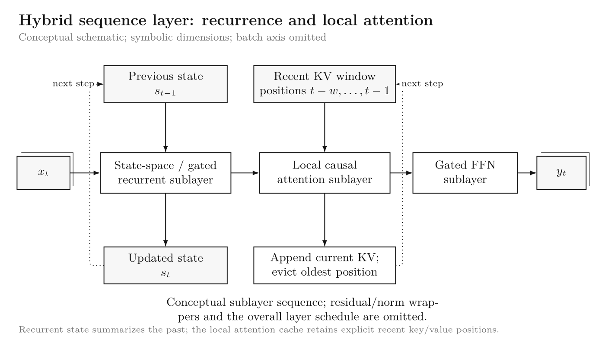](gallery/atlas/text_17_hybrid_attention_ssm.svg) **Hybrid sequence layer: recurrence and local attention** [TikZ](skills/draw-architecture/assets/atlas/text/text_17_hybrid_attention_ssm.tex) · [PDF](gallery/atlas/text_17_hybrid_attention_ssm.pdf) · [PNG](gallery/atlas/text_17_hybrid_attention_ssm.png) | [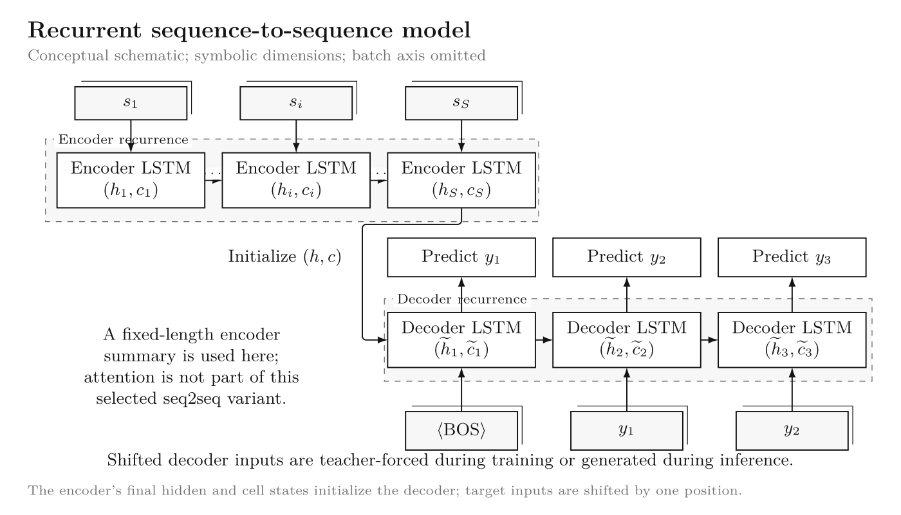](gallery/atlas/text_18_rnn_seq2seq.svg) **Recurrent sequence-to-sequence model** [TikZ](skills/draw-architecture/assets/atlas/text/text_18_rnn_seq2seq.tex) · [PDF](gallery/atlas/text_18_rnn_seq2seq.pdf) · [PNG](gallery/atlas/text_18_rnn_seq2seq.png) |
| [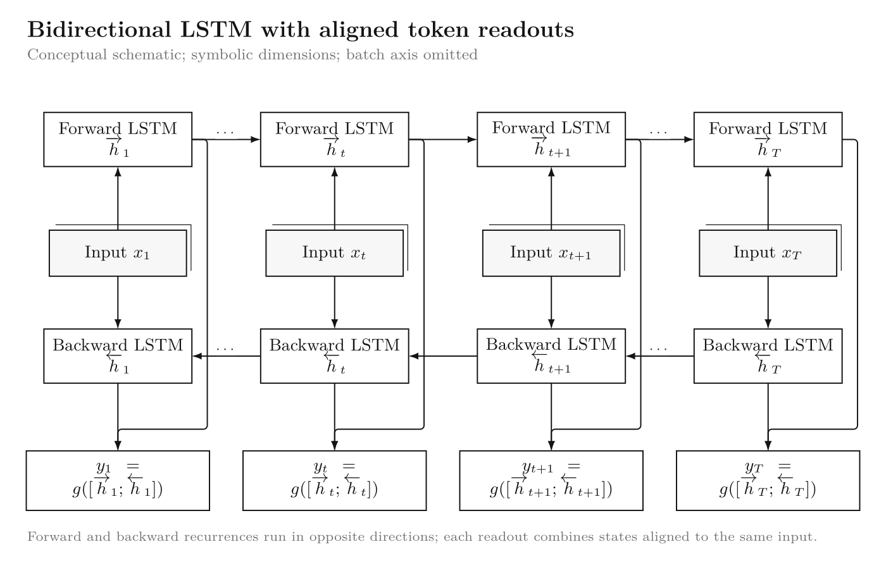](gallery/atlas/text_19_bidirectional_lstm.svg) **Bidirectional LSTM with aligned token readouts** [TikZ](skills/draw-architecture/assets/atlas/text/text_19_bidirectional_lstm.tex) · [PDF](gallery/atlas/text_19_bidirectional_lstm.pdf) · [PNG](gallery/atlas/text_19_bidirectional_lstm.png) | [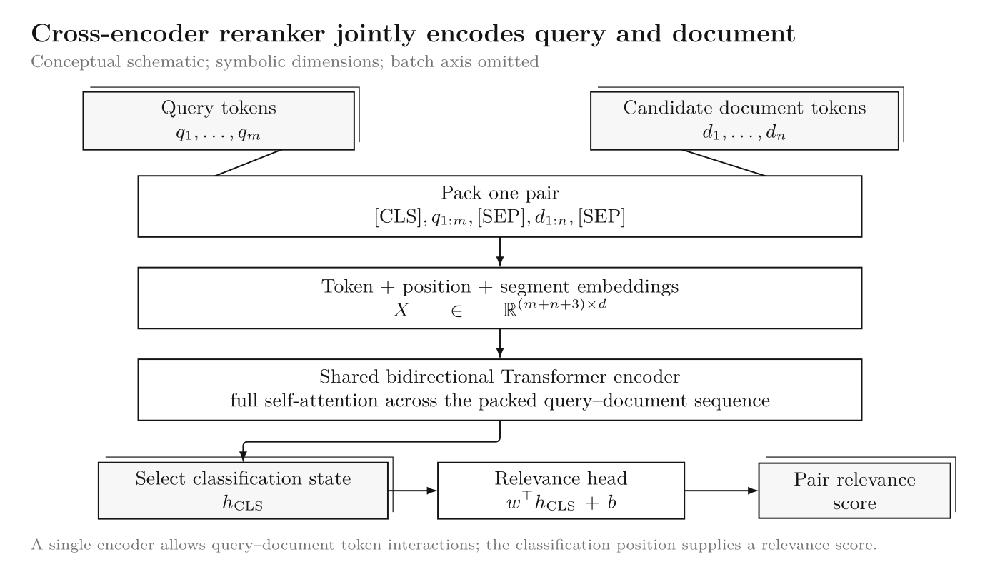](gallery/atlas/text_20_cross_encoder_reranker.svg) **Cross-encoder reranker jointly encodes query and document** [TikZ](skills/draw-architecture/assets/atlas/text/text_20_cross_encoder_reranker.tex) · [PDF](gallery/atlas/text_20_cross_encoder_reranker.pdf) · [PNG](gallery/atlas/text_20_cross_encoder_reranker.png) |

<strong>Audio and speech — 20 original diagrams</strong>

| Figure | Figure |
|---|---|
| [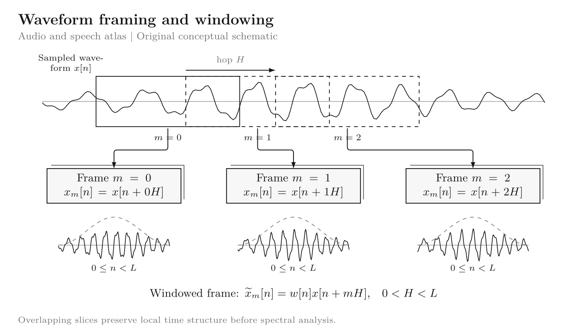](gallery/atlas/audio-01-waveform-framing.svg) **Waveform framing and windowing** [TikZ](skills/draw-architecture/assets/atlas/audio/audio-01-waveform-framing.tex) · [PDF](gallery/atlas/audio-01-waveform-framing.pdf) · [PNG](gallery/atlas/audio-01-waveform-framing.png) | [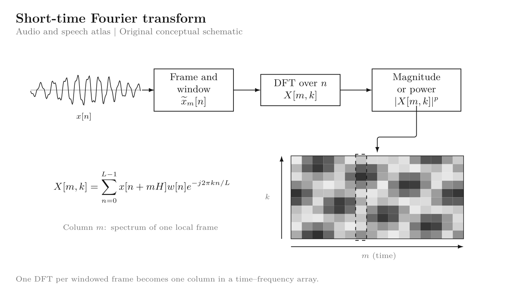](gallery/atlas/audio-02-stft-spectrogram.svg) **Short-time Fourier transform** [TikZ](skills/draw-architecture/assets/atlas/audio/audio-02-stft-spectrogram.tex) · [PDF](gallery/atlas/audio-02-stft-spectrogram.pdf) · [PNG](gallery/atlas/audio-02-stft-spectrogram.png) |
| [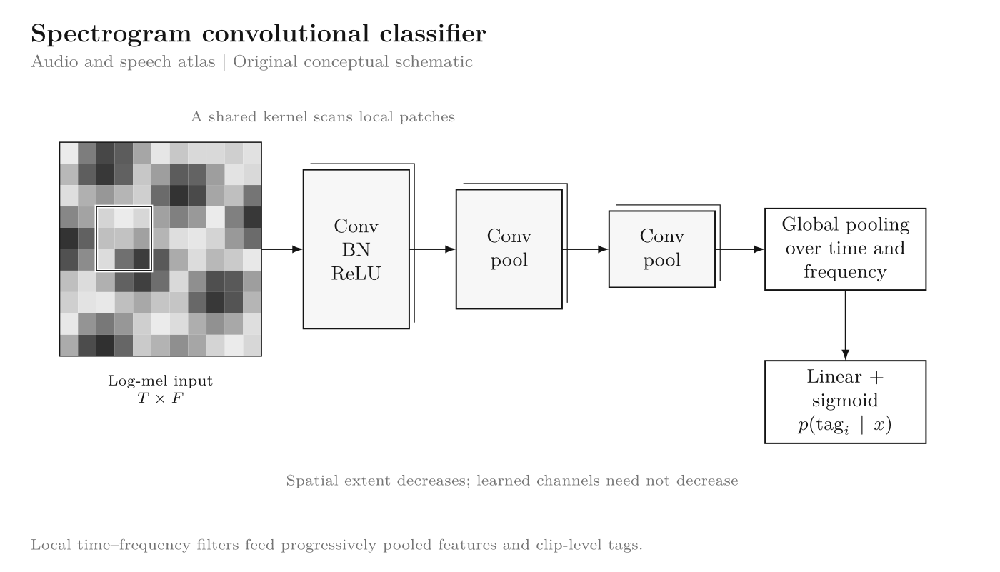](gallery/atlas/audio-03-spectrogram-cnn.svg) **Spectrogram convolutional classifier** [TikZ](skills/draw-architecture/assets/atlas/audio/audio-03-spectrogram-cnn.tex) · [PDF](gallery/atlas/audio-03-spectrogram-cnn.pdf) · [PNG](gallery/atlas/audio-03-spectrogram-cnn.png) | [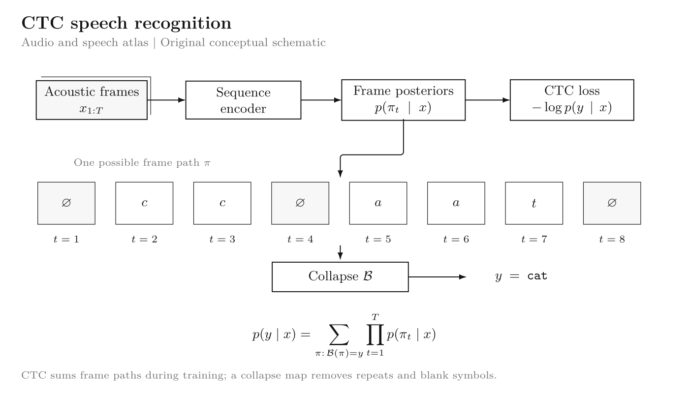](gallery/atlas/audio-04-ctc-recognition.svg) **CTC speech recognition** [TikZ](skills/draw-architecture/assets/atlas/audio/audio-04-ctc-recognition.tex) · [PDF](gallery/atlas/audio-04-ctc-recognition.pdf) · [PNG](gallery/atlas/audio-04-ctc-recognition.png) |
| [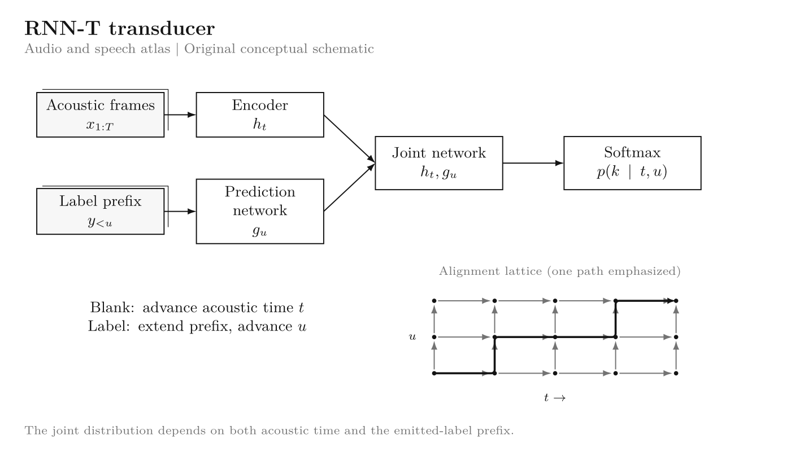](gallery/atlas/audio-05-rnnt-transducer.svg) **RNN-T transducer** [TikZ](skills/draw-architecture/assets/atlas/audio/audio-05-rnnt-transducer.tex) · [PDF](gallery/atlas/audio-05-rnnt-transducer.pdf) · [PNG](gallery/atlas/audio-05-rnnt-transducer.png) | [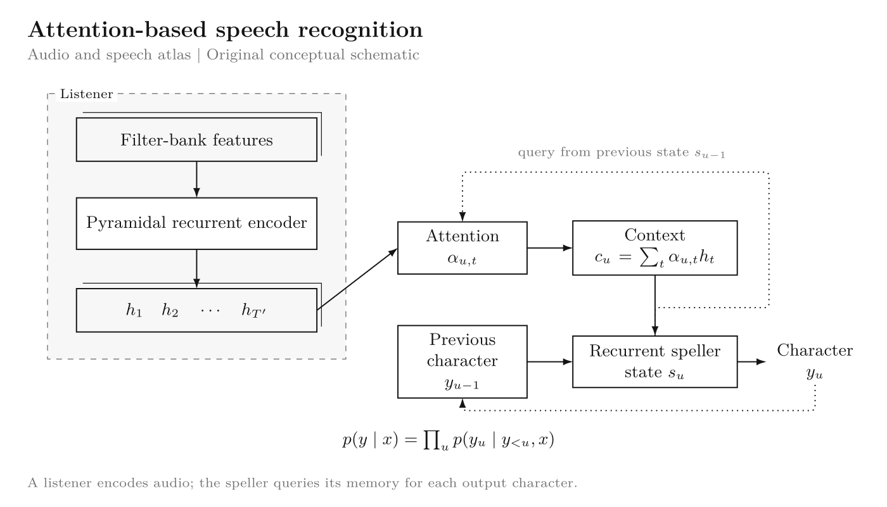](gallery/atlas/audio-06-attention-asr.svg) **Attention-based speech recognition** [TikZ](skills/draw-architecture/assets/atlas/audio/audio-06-attention-asr.tex) · [PDF](gallery/atlas/audio-06-attention-asr.pdf) · [PNG](gallery/atlas/audio-06-attention-asr.png) |
| [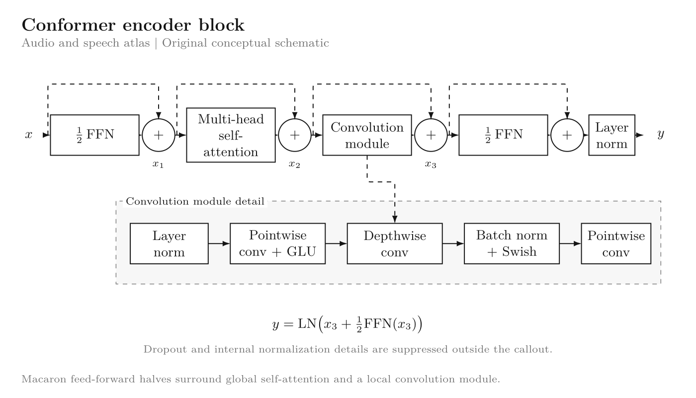](gallery/atlas/audio-07-conformer-block.svg) **Conformer encoder block** [TikZ](skills/draw-architecture/assets/atlas/audio/audio-07-conformer-block.tex) · [PDF](gallery/atlas/audio-07-conformer-block.pdf) · [PNG](gallery/atlas/audio-07-conformer-block.png) | [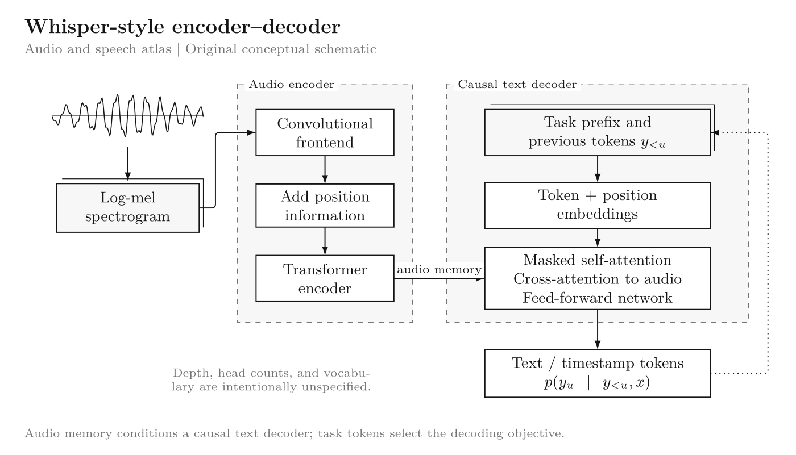](gallery/atlas/audio-08-whisper-encoder-decoder.svg) **Whisper-style encoder--decoder** [TikZ](skills/draw-architecture/assets/atlas/audio/audio-08-whisper-encoder-decoder.tex) · [PDF](gallery/atlas/audio-08-whisper-encoder-decoder.pdf) · [PNG](gallery/atlas/audio-08-whisper-encoder-decoder.png) |
| [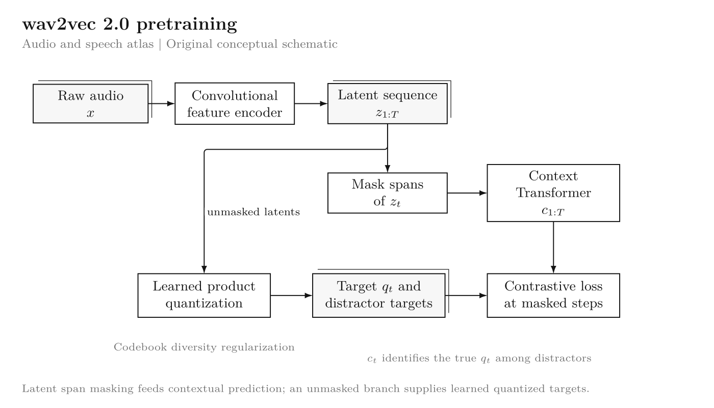](gallery/atlas/audio-09-wav2vec2-pretraining.svg) **wav2vec 2.0 pretraining** [TikZ](skills/draw-architecture/assets/atlas/audio/audio-09-wav2vec2-pretraining.tex) · [PDF](gallery/atlas/audio-09-wav2vec2-pretraining.pdf) · [PNG](gallery/atlas/audio-09-wav2vec2-pretraining.png) |  **HuBERT masked-unit pretraining** [TikZ](skills/draw-architecture/assets/atlas/audio/audio-10-hubert-pretraining.tex) · [PDF](gallery/atlas/audio-10-hubert-pretraining.pdf) · [PNG](gallery/atlas/audio-10-hubert-pretraining.png) |
|  **Speaker embedding with statistics pooling** [TikZ](skills/draw-architecture/assets/atlas/audio/audio-11-speaker-embedding.tex) · [PDF](gallery/atlas/audio-11-speaker-embedding.pdf) · [PNG](gallery/atlas/audio-11-speaker-embedding.png) |  **Speaker diarization by embedding clustering** [TikZ](skills/draw-architecture/assets/atlas/audio/audio-12-speaker-diarization.tex) · [PDF](gallery/atlas/audio-12-speaker-diarization.pdf) · [PNG](gallery/atlas/audio-12-speaker-diarization.png) |
|  **Text-to-speech: two-stage synthesis** [TikZ](skills/draw-architecture/assets/atlas/audio/audio-13-tts-overview.tex) · [PDF](gallery/atlas/audio-13-tts-overview.pdf) · [PNG](gallery/atlas/audio-13-tts-overview.png) |  **Tacotron-style attention TTS** [TikZ](skills/draw-architecture/assets/atlas/audio/audio-14-tacotron-attention-tts.tex) · [PDF](gallery/atlas/audio-14-tacotron-attention-tts.pdf) · [PNG](gallery/atlas/audio-14-tacotron-attention-tts.png) |
|  **FastSpeech 2-style variance adaptor** [TikZ](skills/draw-architecture/assets/atlas/audio/audio-15-fastspeech2-variance.tex) · [PDF](gallery/atlas/audio-15-fastspeech2-variance.pdf) · [PNG](gallery/atlas/audio-15-fastspeech2-variance.png) |  **VITS conceptual training and inference** [TikZ](skills/draw-architecture/assets/atlas/audio/audio-16-vits-conceptual.tex) · [PDF](gallery/atlas/audio-16-vits-conceptual.pdf) · [PNG](gallery/atlas/audio-16-vits-conceptual.png) |
|  **HiFi-GAN neural vocoder** [TikZ](skills/draw-architecture/assets/atlas/audio/audio-17-hifigan-vocoder.tex) · [PDF](gallery/atlas/audio-17-hifigan-vocoder.pdf) · [PNG](gallery/atlas/audio-17-hifigan-vocoder.png) |  **Diffusion vocoder** [TikZ](skills/draw-architecture/assets/atlas/audio/audio-18-diffusion-vocoder.tex) · [PDF](gallery/atlas/audio-18-diffusion-vocoder.pdf) · [PNG](gallery/atlas/audio-18-diffusion-vocoder.png) |
|  **Complex-mask speech enhancement** [TikZ](skills/draw-architecture/assets/atlas/audio/audio-19-speech-enhancement.tex) · [PDF](gallery/atlas/audio-19-speech-enhancement.pdf) · [PNG](gallery/atlas/audio-19-speech-enhancement.png) |  **Residual vector-quantized audio codec** [TikZ](skills/draw-architecture/assets/atlas/audio/audio-20-residual-vq-codec.tex) · [PDF](gallery/atlas/audio-20-residual-vq-codec.pdf) · [PNG](gallery/atlas/audio-20-residual-vq-codec.png) |

<strong>Multimodal and video — 15 original diagrams</strong>

| Figure | Figure |
|---|---|
|  **CLIP contrastive dual encoder** [TikZ](skills/draw-architecture/assets/atlas/multimodal/multimodal-01-clip-dual-encoder.tex) · [PDF](gallery/atlas/multimodal-01-clip-dual-encoder.pdf) · [PNG](gallery/atlas/multimodal-01-clip-dual-encoder.png) |  **Visual question answering** [TikZ](skills/draw-architecture/assets/atlas/multimodal/multimodal-02-visual-question-answering.tex) · [PDF](gallery/atlas/multimodal-02-visual-question-answering.pdf) · [PNG](gallery/atlas/multimodal-02-visual-question-answering.png) |
|  **Attention-based image captioning** [TikZ](skills/draw-architecture/assets/atlas/multimodal/multimodal-03-image-captioning.tex) · [PDF](gallery/atlas/multimodal-03-image-captioning.pdf) · [PNG](gallery/atlas/multimodal-03-image-captioning.png) |  **Vision-language projection bridge** [TikZ](skills/draw-architecture/assets/atlas/multimodal/multimodal-04-vision-language-projector.tex) · [PDF](gallery/atlas/multimodal-04-vision-language-projector.pdf) · [PNG](gallery/atlas/multimodal-04-vision-language-projector.png) |
|  **Resampling with gated visual cross-attention** [TikZ](skills/draw-architecture/assets/atlas/multimodal/multimodal-05-resampler-cross-attention.tex) · [PDF](gallery/atlas/multimodal-05-resampler-cross-attention.pdf) · [PNG](gallery/atlas/multimodal-05-resampler-cross-attention.png) |  **Audio-text contrastive learning and zero-shot scoring** [TikZ](skills/draw-architecture/assets/atlas/multimodal/multimodal-06-clap-audio-text.tex) · [PDF](gallery/atlas/multimodal-06-clap-audio-text.pdf) · [PNG](gallery/atlas/multimodal-06-clap-audio-text.png) |
|  **Speech-to-language-model bridge** [TikZ](skills/draw-architecture/assets/atlas/multimodal/multimodal-07-speech-language-bridge.tex) · [PDF](gallery/atlas/multimodal-07-speech-language-bridge.pdf) · [PNG](gallery/atlas/multimodal-07-speech-language-bridge.png) |  **Video temporal encoder** [TikZ](skills/draw-architecture/assets/atlas/multimodal/multimodal-08-video-temporal-encoder.tex) · [PDF](gallery/atlas/multimodal-08-video-temporal-encoder.pdf) · [PNG](gallery/atlas/multimodal-08-video-temporal-encoder.png) |
|  **Audio-visual speech fusion** [TikZ](skills/draw-architecture/assets/atlas/multimodal/multimodal-09-audiovisual-speech-fusion.tex) · [PDF](gallery/atlas/multimodal-09-audiovisual-speech-fusion.pdf) · [PNG](gallery/atlas/multimodal-09-audiovisual-speech-fusion.png) |  **Early fusion versus late fusion** [TikZ](skills/draw-architecture/assets/atlas/multimodal/multimodal-10-early-versus-late-fusion.tex) · [PDF](gallery/atlas/multimodal-10-early-versus-late-fusion.pdf) · [PNG](gallery/atlas/multimodal-10-early-versus-late-fusion.png) |
|  **Vision-language-action policy** [TikZ](skills/draw-architecture/assets/atlas/multimodal/multimodal-11-vision-language-action.tex) · [PDF](gallery/atlas/multimodal-11-vision-language-action.pdf) · [PNG](gallery/atlas/multimodal-11-vision-language-action.png) |  **RGB-depth fusion at multiple scales** [TikZ](skills/draw-architecture/assets/atlas/multimodal/multimodal-12-rgb-depth-fusion.tex) · [PDF](gallery/atlas/multimodal-12-rgb-depth-fusion.pdf) · [PNG](gallery/atlas/multimodal-12-rgb-depth-fusion.png) |
|  **Document language-layout-vision fusion** [TikZ](skills/draw-architecture/assets/atlas/multimodal/multimodal-13-document-layout-language-vision.tex) · [PDF](gallery/atlas/multimodal-13-document-layout-language-vision.pdf) · [PNG](gallery/atlas/multimodal-13-document-layout-language-vision.png) |  **Retrieval-augmented multimodal generation** [TikZ](skills/draw-architecture/assets/atlas/multimodal/multimodal-14-retrieval-augmented-generation.tex) · [PDF](gallery/atlas/multimodal-14-retrieval-augmented-generation.pdf) · [PNG](gallery/atlas/multimodal-14-retrieval-augmented-generation.png) |
|  **Multimodal mixture-of-experts routing** [TikZ](skills/draw-architecture/assets/atlas/multimodal/multimodal-15-mixture-of-experts.tex) · [PDF](gallery/atlas/multimodal-15-mixture-of-experts.pdf) · [PNG](gallery/atlas/multimodal-15-mixture-of-experts.png) |  |

<strong>Agentic systems — 15 original diagrams</strong>

| Figure | Figure |
|---|---|
|  **ReAct: interleaved reasoning, action, and observation** [TikZ](skills/draw-architecture/assets/atlas/agents/agents-01-react-loop.tex) · [PDF](gallery/atlas/agents-01-react-loop.pdf) · [PNG](gallery/atlas/agents-01-react-loop.png) |  **Plan and execute with progress-aware replanning** [TikZ](skills/draw-architecture/assets/atlas/agents/agents-02-plan-execute.tex) · [PDF](gallery/atlas/agents-02-plan-execute.pdf) · [PNG](gallery/atlas/agents-02-plan-execute.png) |
|  **Tool-call and result protocol** [TikZ](skills/draw-architecture/assets/atlas/agents/agents-03-tool-protocol.tex) · [PDF](gallery/atlas/agents-03-tool-protocol.pdf) · [PNG](gallery/atlas/agents-03-tool-protocol.png) |  **Bounded reflection and revision** [TikZ](skills/draw-architecture/assets/atlas/agents/agents-04-bounded-reflection.tex) · [PDF](gallery/atlas/agents-04-bounded-reflection.pdf) · [PNG](gallery/atlas/agents-04-bounded-reflection.png) |
|  **Supervisor with tool-wrapped specialist agents** [TikZ](skills/draw-architecture/assets/atlas/agents/agents-05-supervisor.tex) · [PDF](gallery/atlas/agents-05-supervisor.pdf) · [PNG](gallery/atlas/agents-05-supervisor.png) |  **Parallel research with evidence reduction** [TikZ](skills/draw-architecture/assets/atlas/agents/agents-06-parallel-research.tex) · [PDF](gallery/atlas/agents-06-parallel-research.pdf) · [PNG](gallery/atlas/agents-06-parallel-research.png) |
|  **Debate with an explicit adjudicator** [TikZ](skills/draw-architecture/assets/atlas/agents/agents-07-debate-adjudicator.tex) · [PDF](gallery/atlas/agents-07-debate-adjudicator.pdf) · [PNG](gallery/atlas/agents-07-debate-adjudicator.png) |  **RAG: separate indexing from per-query generation** [TikZ](skills/draw-architecture/assets/atlas/agents/agents-08-rag-lifecycles.tex) · [PDF](gallery/atlas/agents-08-rag-lifecycles.pdf) · [PNG](gallery/atlas/agents-08-rag-lifecycles.png) |
|  **Hybrid retrieval with reciprocal rank fusion** [TikZ](skills/draw-architecture/assets/atlas/agents/agents-09-hybrid-fusion.tex) · [PDF](gallery/atlas/agents-09-hybrid-fusion.pdf) · [PNG](gallery/atlas/agents-09-hybrid-fusion.png) |  **Corrective RAG with route-dependent evidence** [TikZ](skills/draw-architecture/assets/atlas/agents/agents-10-corrective-rag.tex) · [PDF](gallery/atlas/agents-10-corrective-rag.pdf) · [PNG](gallery/atlas/agents-10-corrective-rag.png) |
|  **Thread state and cross-session memory** [TikZ](skills/draw-architecture/assets/atlas/agents/agents-11-memory-scopes.tex) · [PDF](gallery/atlas/agents-11-memory-scopes.pdf) · [PNG](gallery/atlas/agents-11-memory-scopes.png) |  **Event-driven agent workflow with durable state** [TikZ](skills/draw-architecture/assets/atlas/agents/agents-12-event-workflow.tex) · [PDF](gallery/atlas/agents-12-event-workflow.pdf) · [PNG](gallery/atlas/agents-12-event-workflow.png) |
|  **Human approval checkpoint before side effects** [TikZ](skills/draw-architecture/assets/atlas/agents/agents-13-human-approval.tex) · [PDF](gallery/atlas/agents-13-human-approval.pdf) · [PNG](gallery/atlas/agents-13-human-approval.png) |  **Sandboxed code execution with explicit result capture** [TikZ](skills/draw-architecture/assets/atlas/agents/agents-14-sandbox-execution.tex) · [PDF](gallery/atlas/agents-14-sandbox-execution.pdf) · [PNG](gallery/atlas/agents-14-sandbox-execution.png) |
|  **Distributed inference with tensor-parallel serving** [TikZ](skills/draw-architecture/assets/atlas/agents/agents-15-distributed-serving.tex) · [PDF](gallery/atlas/agents-15-distributed-serving.pdf) · [PNG](gallery/atlas/agents-15-distributed-serving.png) |  |

<strong>Robotics and graph learning — 10 original diagrams</strong>

| Figure | Figure |
|---|---|
|  **Perception--action closed loop** [TikZ](skills/draw-architecture/assets/atlas/robotics-graphs/rg01-perception-action-loop.tex) · [PDF](gallery/atlas/rg01-perception-action-loop.pdf) · [PNG](gallery/atlas/rg01-perception-action-loop.png) |  **Hierarchical robot policy** [TikZ](skills/draw-architecture/assets/atlas/robotics-graphs/rg02-hierarchical-policy.tex) · [PDF](gallery/atlas/rg02-hierarchical-policy.pdf) · [PNG](gallery/atlas/rg02-hierarchical-policy.png) |
|  **Model-predictive control** [TikZ](skills/draw-architecture/assets/atlas/robotics-graphs/rg03-model-predictive-control.tex) · [PDF](gallery/atlas/rg03-model-predictive-control.pdf) · [PNG](gallery/atlas/rg03-model-predictive-control.png) |  **Simulation training and robot deployment** [TikZ](skills/draw-architecture/assets/atlas/robotics-graphs/rg04-sim-to-real.tex) · [PDF](gallery/atlas/rg04-sim-to-real.pdf) · [PNG](gallery/atlas/rg04-sim-to-real.png) |
|  **Robot sensor fusion** [TikZ](skills/draw-architecture/assets/atlas/robotics-graphs/rg05-sensor-fusion.tex) · [PDF](gallery/atlas/rg05-sensor-fusion.pdf) · [PNG](gallery/atlas/rg05-sensor-fusion.png) |  **Graph message passing** [TikZ](skills/draw-architecture/assets/atlas/robotics-graphs/rg06-graph-message-passing.tex) · [PDF](gallery/atlas/rg06-graph-message-passing.pdf) · [PNG](gallery/atlas/rg06-graph-message-passing.png) |
|  **Graph attention** [TikZ](skills/draw-architecture/assets/atlas/robotics-graphs/rg07-graph-attention.tex) · [PDF](gallery/atlas/rg07-graph-attention.pdf) · [PNG](gallery/atlas/rg07-graph-attention.png) |  **Graph-level readout** [TikZ](skills/draw-architecture/assets/atlas/robotics-graphs/rg08-graph-readout.tex) · [PDF](gallery/atlas/rg08-graph-readout.pdf) · [PNG](gallery/atlas/rg08-graph-readout.png) |
|  **Heterogeneous graph network** [TikZ](skills/draw-architecture/assets/atlas/robotics-graphs/rg09-heterogeneous-graph.tex) · [PDF](gallery/atlas/rg09-heterogeneous-graph.pdf) · [PNG](gallery/atlas/rg09-heterogeneous-graph.png) |  **Spatiotemporal graph forecasting** [TikZ](skills/draw-architecture/assets/atlas/robotics-graphs/rg10-spatiotemporal-graph.tex) · [PDF](gallery/atlas/rg10-spatiotemporal-graph.pdf) · [PNG](gallery/atlas/rg10-spatiotemporal-graph.png) |

## Design and provenance

Sebastian Raschka's architecture explanations informed the emphasis on clear main streams, correct residual origins, repeated-block braces, and separated detail callouts. The user requested a primarily black-and-white LaTeX treatment, so this atlas uses its own original monochrome drawings. It does not include Raschka's original image collection, seals, or watermarks and is not affiliated with him. [Study and source notes](skills/draw-architecture/references/sources.md) · [Monochrome design guide](skills/draw-architecture/references/monochrome-design.md).

The catalog also covers all 11 unique originally requested projects: NNTikZ, PlotNeuralNet, awesome-latex-drawing, awesome-tikz, PetarV-/TikZ, nndiagram, pytorch2tikz, transformer-verif, tikz-codes, Tikz_graphs, and nn_graphics. They are linked with pinned revisions and observed licenses, rather than bundled indiscriminately. The custom academic/non-commercial pytorch2tikz license and unclear image licenses are documented.

Every atlas figure records its own primary technical sources and assumptions in the family index and downloadable metadata. Study downloads remain separate from the publishable original assets.

## Build and verification

~~~bash
python -m unittest discover -s tests -v
python scripts/build_gallery.py --compile-tex
python scripts/build_atlas.py --jobs 4
python scripts/build_contact_sheets.py
~~~

The atlas build compiles all 100 native masters, rejects overfull TeX boxes and missing glyphs, and exports the gallery. It verifies PNG payloads, SVG XML, source hashes, metadata, and PDF end markers, including cached files. It caches by source SHA-256; use <code>--force</code> for a clean rebuild. Contact-sheet generation additionally needs Pillow. The six family generators can reproduce the initial masters; regenerating can overwrite subsequent manual edits.

Six agents independently authored and reviewed their assigned families. Figures were compiled and inspected through contact sheets and detailed reviews of complex routing, equations, grids, residuals, and objectives. Automated checks support review; they do not prove semantic correctness. [Actual validation record](docs/VALIDATION.md).

## Repository layout

| Path | Contents |
|---|---|
| skills/draw-architecture/assets/atlas/ | 100 standalone TikZ masters and six family source indexes |
| skills/draw-architecture/scripts/ | Template search/copy, original TikZ primitives, JSON renderer |
| skills/draw-architecture/references/ | Architecture, source, notation, typography, and review guides |
| gallery/atlas/ | 100 compiled figures, reports, metadata, contact sheets |
| docs/ATLAS.md | Complete figure/download catalog |
| scripts/ | Installation, reproducible build, and gallery maintenance |
| index.html, app/ | Searchable static gallery and local agent-prompt composer |

The Hugging Face repository is a static gallery and downloadable skill repository. It does not require a GPU, model API key, or inference endpoint. The same original sources are on [GitHub](https://github.com/Hisernberg/archdiagram-studio) and [Hugging Face](https://huggingface.co/spaces/Nabidnur/archdiagram-studio/tree/main).

Original code, diagrams, templates, and prose: **MIT**, copyright 2026 URAD. External work retains its authorship and licensing. [LICENSE](LICENSE) · [CITATION.cff](CITATION.cff) · [Contributing](CONTRIBUTING.md).
